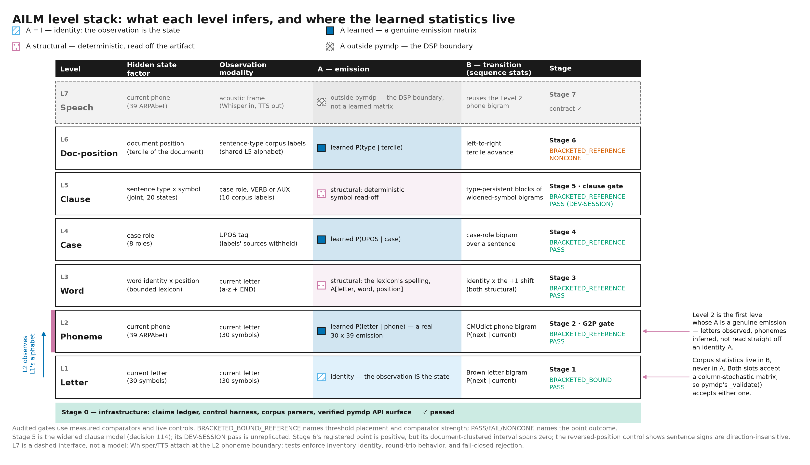

# Active Inference Language Model (AILM)

AILM's contribution is two things, both explicit: a discrete probabilistic
language-level stack, L1 through L6, with every level declared in Generalized
Notation Notation (GNN) — the Active Inference Institute's structured notation
for generative models — and conformance-checked against the live
[pymdp](https://github.com/infer-actively/pymdp) `Agent` object (inferactively-pymdp)
that declaration describes, with no transformer, no neural network, and no
learned embedding anywhere in it; and a gate-audit and claims-ledger method that
makes every recorded number checkable — a single-writer ledger backs every
quantitative claim in this repository's prose, and every stage gate is scored
against a live positive and negative control before it counts as passing.
External LLM probes (served via a local or hosted transport) are an accessory
reference frame used for comparison, not part of AILM's own model stack. It is
a research system for bounded filtering and lexical generation, with no
behavioral comprehension claim or general-purpose conversational interface.

## At a glance

The public source is available on [GitHub](https://github.com/ActiveInferenceInstitute/active_inference_language_model).
The `v1.0.0` GitHub release remains a draft. Its Zenodo deposition reserves
[10.5281/zenodo.22409419](https://doi.org/10.5281/zenodo.22409419) but is not yet
published; the DOI does not yet resolve publicly. The retained release
verification describes the earlier frozen candidate. The current manuscript
and companions are prepared for review; replacing the release requires current
source-bound acceptance.


The recorded stage results cover discrete levels and separately measured
cross-level interventions. A connected development runtime now executes live
GNN-built agents with explicit message timing and conditional next-word generation;
its corpus comparison is reported separately from the historical stage scores. Gate outcomes,
the paper, and the decision log are linked throughout this document; start
with [`docs/hierarchy.md`](docs/hierarchy.md) if you want the governing
description, [`docs/guides/quickstart.md`](docs/guides/quickstart.md) if you want a
running checkout, or [`docs/README.md`](docs/README.md#start-here) for a short
start-here path by audience (newcomer, reviewer, contributor), with a
[glossary](docs/reference/glossary.md) of every project-specific term.

> **Data-use notice:** the repository and built wheel include Brown-derived
> material subject to NLTK's non-commercial-use metadata and Czech-PDTC-derived
> material under CC BY-NC-SA 4.0. The source distribution also includes the GUM
> evaluation input under CC BY-NC-SA 4.0. See [`LICENSE`](LICENSE) and
> [`THIRD_PARTY_NOTICES.md`](THIRD_PARTY_NOTICES.md) for the component inventory
> and upstream terms.

---

## What this is

AILM implements six discrete state spaces, one per level, each a description of
the same text at a different grain:

```
letter · phoneme · word (factored word+position, trie induced) · case · clause · document position
```



The separators are dots rather than arrows because the levels are not stages of
one pipeline in the historical stage evaluations: those default level scorers
operate independently. The opt-in connected runtime is described below. Each level is a proper pymdp generative model.
They compose in ways weaker than the word *hierarchy* suggests. Some share an
alphabet — a level's observation space is the level below's
state space, so the letter-to-phone emission is
`A[0, letter, phone] = P(letter | phone)` — which is a type identity fixed when
the matrices are built, with nothing flowing along it at run time. The rest is
measured receiver interventions, not assumed messages: `update_empirical_prior` is
within-level temporal recursion at every call site, while each reported
receiver intervention is a recorded experiment. The measured interventions are:
L1 letters → L2B letter-to-phone is significantly
harmful (`docs/decisions.md` entry 9), the lexical L3 → L2B message helps at every
tested weight, with an interior argmax the sweep does not distinguish from a
plateau (entries 19 and 110), the document-position (tercile) → clause
prior intervention (`narrative` in code) is measured (entry 26),
the L3 → L1g generation seam works (entry 17), and the privileged
punctuation-type-oracle → L3 word-prior intervention helps on both recorded
directional summaries, falsifying its predicted harm (entries 27 and 88). That
last arm does not use an L5 posterior. The L3→L1g generation run, L6→L5
`D`-prior intervention, and oracle→L3 `D`-prior intervention are independently
measured experiments. Those recorded runs did not connect their interventions
into a document-to-letter cascade. Generation by policy selection
under expected free energy G(π) is built at L1g with L3 lexical preferences; the
policy posterior is computed in closed form (`efe_policy_posterior`) and
verified against `agent.infer_policies`, with the agreement recorded — see
`docs/decisions.md` entries 17 and 95 and the status list below.

The connected runtime uses `ailm.levels.connected.ConnectedRuntime` with
`load_connected_model()` from `ailm.levels.connected_builder`. `infer_text()`
normalizes raw text into ASCII lexical runs; `infer_document()` accepts the typed
`Sentence` and `Token` contract, optionally with external UPOS observations.
`generate_next_word()` uses the inferred context and live L1g policy selection.
The composition is a causal schedule of conditional updates, with train-only
bridge kernels, named channel ablations and reset boundaries. It is not an exact
posterior for a single global generative model. See the
[connected runtime contract](docs/design/connected_runtime.md) for its assumptions,
observation boundary and executable example. Existing stage and channel results
remain evidence for their original populations and estimands. On the locally
frozen GUM raw-text population, the equal-document normalized-character log-loss
gain (disconnected minus connected) is claim:connected_gum_document_mean_gain
nats, with interval [claim:connected_gum_document_ci_low,
claim:connected_gum_document_ci_high] across claim:connected_gum_documents
documents after excluding claim:connected_gum_excluded_documents previously
inspected documents. Vocabulary coverage is claim:connected_gum_vocab_coverage_pct%;
claim:connected_gum_oov_tokens out-of-vocabulary tokens remain in the scored
stream. Full-stream closed-vocabulary word loss is infinite, as recorded by the
`connected_gum_word_loss_is_infinite` ledger flag. This is a local
prospective comparison, not external registration or replication; the
[manuscript results](docs/manuscript/04_results.md#sec:connected_gum) state the
normalized-stream and conditional-inference limits.

The installed wheel includes the runtime's GNN specifications and bounded data
artifacts. Its library API works outside a source checkout:

```python
from ailm.levels.connected import ConnectedRuntime
from ailm.levels.connected_builder import load_connected_model

runtime = ConnectedRuntime(load_connected_model())
result = runtime.infer_text("the man.")
next_word = runtime.generate_next_word(result)
```

`scripts/run_connected_ailm.py` is a source-checkout convenience, not an installed
console command.

The case structure (Level 4 — syntactic case roles (UD-derived), not
grammatical case) is grounded in two of the author's papers:
- **CEREBRUM** (Friedman 2025) — the core case ontology, a separate novel
  Generative role, structurally distinct case free-energy formulations, and the
  [Supplement {{CEREBRUM_POMDP_SUPPLEMENT}}]({{CEREBRUM_POMDP_SUPPLEMENT_URL}}) POMDP tuple
- **Compositional Approaches to Linguistic Case for Cognitive Modeling**
  (Friedman 2026) — enriched categorical formalism, the belief update equation
  `q^(t+1)(c_k) ∝ q^(t)(c_k) · exp(w_k · o_k)`, and a case-typed DisCoCat
  analysis in `FVect`/`FinHilb`. AILM does not implement or claim a DisCoCat
  meaning functor; its measured compositions are explicit stochastic kernels.

Exact record identities for both papers, including where a Zenodo record and its
deposited PDF disagree, are pinned in
[`data/reference_sources.json`](data/reference_sources.json) and summarized in
[`AGENTS.md`](AGENTS.md#paper-references).

---

## What this is not

| What AILM is NOT | What it uses instead |
|-----------------|---------------------|
| A transformer | pymdp discrete state-space agents |
| A neural language model | Factorized A/B matrices |
| A system with learned embeddings | Stochastic maps (discrete probability distributions) |
| A system using `update_A` / `update_B` | `infer_parameters` for learning |
| A black box | Every factor, every matrix, every case role named and traceable |

---

## What is built

Stages 0-6 are built and have recorded gate outcomes; Stage 7 (speech) is
scoped to a boundary interface contract. Built is not passed: the list below
inventories what exists and states each recorded outcome beside it, and the
gate table in [`AGENTS.md`](AGENTS.md#stage-gates) carries the per-stage
verdict. The original Stage 1-4 gates were restated after those levels had been
built or measured, and later stage declarations were re-scoped during audit; the
chronology is in [`AGENTS.md`](AGENTS.md) and
[`docs/decisions.md`](docs/decisions.md).

1. `ailm.cases` — the core `CaseRole` inventory; scoped core and novel `CerebrumFunctionRole` values; the exact CEREBRUM tuple; an explicitly AILM-owned pymdp heuristic; source-structured case formulations; and a fail-closed scalar NOM/ACC scaffold
2. `ailm.claims` — `ClaimsLedger`: verifies `claim:<label>` provenance and detects high-signal bare quantitative prose
3. `ailm.control` — `ControlHarness` + `GateVacuousError`: every gate requires positive AND negative control
4. `ailm.corpus.cmudict` — CMUdict download/parse; the canonical ARPAbet has claim:phoneme_count_39 phonemes (comment stripping applied — naive parsing yields claim:phoneme_count_naive_unstripped)
5. `ailm.corpus.ud` — UD English EWT download/parse; 8-case oracle (NOM/ACC/GEN morphological; DAT/INS/LOC/ABL from deprel mapping — **research claim, not ground truth**)
6. `ailm.generative.smoke` — pymdp API surface verified: `A_dependencies` factorization, `update_empirical_prior` (within-level temporal recursion), `infer_parameters` (not `update_A`), `infer_policies` output shape
7. **L1 (letters)** — Brown bigram transition; clears the restated context-free unigram bar
8. **L2 (phonemes)** — phoneme bigram clears the unigram bar; position-aligned letter-to-phone decoding clears the per-letter argmax bar (paired McNemar)
9. **L3 (words)** — trie-constrained paths; clears the restated letter-bigram bar on identical positions
10. **L4 (cases)** — 8-case assignment; gold morphology oracle vs derived oracle, restated by population; the derived comparison **replicates and crosses the frozen family threshold** on the held-back UD EWT test split, while the gold comparison again yields no discordant pair (decision 111)
11. **L5 (clauses)** — the widened-observation clause model, case roles plus one distinguished symbol each for `VERB` and `AUX`, is the canonical clause level (decisions 112 and 114). Its gate was registered before its artifact existed and **passes** on the document-disjoint population, `BRACKETED_REFERENCE`, with the privileged-label gain **resolved away from zero** under paired whole-document bootstrap and the detectability control live. It is a development-session specification, so its labels are descriptive, and it has no held-back replication because the population is spent. The case-only clause model it displaced is retained as an ablation with its record intact: gate **non-passing**, `ABOVE_REFERENCE`; privileged-label gain **unresolved** (decisions 83 and 85); **replicated non-passing** on the held-back UD EWT test split with zero discordant pairs over claim:confirmatory_stage5_sentences sentences (decision 111)
12. **L6 (document-position terciles)** — preregistered positive point estimate; the document-clustered primary interval **spans zero** on the development population (decisions 25-26 and their correction); the sentence-level observed-position sign test **replicates and crosses the frozen family threshold** on the held-back UD EWT test split (decision 111); the document-level primary estimand, registered separately, **excludes zero** on that same split over claim:confirmatory_stage6_clustered_documents documents, [claim:confirmatory_stage6_clustered_ci_low, claim:confirmatory_stage6_clustered_ci_high] at claim:confirmatory_stage6_clustered_confidence_pct percent (decision claim:confirmatory_stage6_clustered_decision). Read with its three recorded limits: the development interval is not retracted, the same bootstrap at the family-corrected claim:confirmatory_stage6_clustered_corrected_confidence_pct percent spans zero, and the split's own resolution of claim:confirmatory_stage6_clustered_min_detectable_effect_nats nats is coarser than the development effect of claim:confirmatory_stage6_clustered_control_planted_shift_nats nats, so a null there would have been uninterpretable
13. **Generation** — L3→L1g policy selection under expected free energy, built and measured
14. **Coupling** — inter-level message measured (harmful)
15. **Lexical channel** — L3→L2B constraint (helps, prospectively specified in-session)
16. **Typed word-prior intervention** — a privileged punctuation-type oracle→L3 arm helps on aggregate perplexity and token direction; the predicted harm did not reproduce, but no L5 output is tested (decisions 27 and 88)
17. **Confirmatory replication** — the four UD EWT members of the frozen sixteen-member significance family, scored exactly once against the whole of the held-back `en_ewt-ud-test.conllu` (claim:confirmatory_census_sentences sentences, claim:confirmatory_census_documents documents, disjoint from every development document) with parameters read unchanged from the development fits; two cross, two are uncomputable, and the population is spent (decision 111)

**Full suite:**
Build the generated standalone interface, then run the suite through the
project interpreter:

```bash
.venv/bin/python scripts/export_web_model.py
.venv/bin/python scripts/build_web_ailm.py
.venv/bin/python -m pytest tests/ -v --cov=ailm
```

---

**Status at a glance.** Levels L1 through L4 clear gates that were restated
after those levels had been built or measured. L5 clears a gate that was
registered before its artifact existed, on the widened observation alphabet of
decision 112, which decision 114 made the canonical clause level; that gate is
a development-session specification and has no held-back replication, because
the held-back population was already spent. The case-only clause model it
displaced is retained as an ablation, and its record is unchanged: gate
non-passing, privileged-label gain unresolved, and non-passing again on the
held-back split. L6 has a preregistered positive point
estimate whose document-clustered primary interval spans zero on the development
population and excludes zero on the held-back one. Four of these results have since been rescored exactly once
against a held-back split nothing here had scored, under the pre-registration
of decision 79, executed as decision 111: the Stage 4 derived case comparison and the Stage 6 sign test
cross the frozen family threshold there in their recorded directions, while the
Stage 4 gold comparison and the Stage 5 classification produce no discordant
pair and remain not shown rather than shown absent. The other twelve members
of the frozen family are development-population inference, and no run can
repeat: the population is spent. Stage 7 (speech) is a boundary interface contract, not a
model. The named factors and A/B/C/D arrays give parameter-level explicitness
and structural traceability, not a general claim of mechanistic
interpretability; which score paths run live pymdp filtering and which use an
identified exact or NumPy computation is stated in
[`docs/hierarchy.md`](docs/hierarchy.md), which governs. The paper is authored in
`docs/manuscript/` and rendered to `output/pdf/`; the decisions log is
[`docs/decisions.md`](docs/decisions.md); the operating reference for
contributors and agents is [`AGENTS.md`](AGENTS.md).

---

## Honest Scope Statement

**What is built:** letters, phonemes, words, syntactic case roles
(UD-derived), clauses, document-position terciles — each with a live pymdp
`Agent` builder and a recorded gate with positive and negative controls. The
headline scores are not all live-agent inference: L1 uses pymdp filtering;
L2A's full-dictionary score is an exact sufficient-statistic calculation and
L2B's full-set score is a NumPy forward filter, each checked against a bounded
live-Agent result; L3 uses an exact score; L4 uses NumPy filtering that the
live Agent reproduces at every held-out position, with the agreement recorded;
L5 uses an exact closed-form mixture with a recorded live-agent
posterior-agreement check (argmax and joint-posterior tolerance) on the full
held-out set, which is not score equivalence for the headline estimand; and
L6's registered observed-position score is direct NumPy, with a separate
descriptive live-agent sequential score. L3→L1g generation by policy
selection is built and measured. Stage 7 (speech) is an interface contract, not
a model.

**What that does not mean:** AILM is a closed-vocabulary research system, not a
usable language model. Comprehension runs one level at a time in the shipped
decoders; generation is next-symbol commitment under expected free energy at
the separate L3→L1g seam, scored on held-out corpus statistics rather than on anything a reader
would call fluency. Level 5's gate passes only as a **development-session
specification with no held-back replication**, its retained case-only ablation
is **non-passing with an unresolved privileged-label gain**, and one measured
receiver intervention made the system significantly worse. Each level's score and
its limitations are stated together, never apart.

**The architecture is tractable at the word level:** word identity and position
remain separate hidden factors with separate `B` transitions, avoiding a dense
joint word×position transition. `A_dependencies=[[0, 1]]` states accurately that
the deterministic spelling likelihood observes both factors; it is not itself
the source of the transition-memory saving.

**The case oracle is a research claim:** English is morphologically impoverished.
Only NOM/ACC/GEN have morphological marking. DAT/INS/LOC/ABL are derived via
Universal Dependencies deprel mapping — a principled heuristic, not ground truth.

**Generation via policy selection:** Neither CEREBRUM nor Cognitive Case Diagrams
provides a generation mechanism (both do comprehension). AILM's implemented
generation mechanism is the L3→L1g seam: policies are next-letter commitments
scored by G(π), L3 supplies lexical next-letter preferences through `C`, and a
Brown-bigram habit supplies `E`. The L6→L5 model-output intervention and the
punctuation-type-oracle→L3 prior intervention are separate experiments, not
upstream stages of this generator.

---

## Installation

The public release destination is
[ActiveInferenceInstitute/Active_Inference_Language_Model](https://github.com/ActiveInferenceInstitute/Active_Inference_Language_Model).
These installation instructions target the versioned public release `v1.0.0`.

```bash
git clone --branch v1.0.0 https://github.com/ActiveInferenceInstitute/Active_Inference_Language_Model.git active_inference_language_model
cd active_inference_language_model

# Install (supports Python >=3.11; the maintained development environment uses 3.12 and uv)
uv sync

# Run the full suite against the project's own interpreter.
# Never `uv run pytest` here — in this sidecar it can resolve to a system
# pytest with the wrong Python and a different pymdp. See docs/guides/quickstart.md § 2.
.venv/bin/python scripts/export_web_model.py
.venv/bin/python scripts/build_web_ailm.py
.venv/bin/python -m pytest tests/ -v --cov=ailm --cov-report=term-missing
```

---

## Usage

The fastest way to see the shipped code do something is the offline newcomer
demo — no network, no re-measurement, no ledger writes, just the committed
gate-verdict table and one live decode:

```bash
.venv/bin/python -m ailm                # or: ailm-demo
.venv/bin/python -m ailm galaxy --top-k 5
```

It prints the committed Stage 1-6 gate-verdict table read from
`output/reports/gate_audit.json`, then runs a real Stage 2B G2P decode of one
word through a freshly built `pymdp` agent, showing the full per-position
posterior rather than only the argmax. The first call in a fresh environment
pays JAX's one-time import/compilation cost and can take a minute or two with
no console output in between; every call after that is fast. This needs a
source checkout — `output/` and `data/` are intentionally not embedded in the
installed wheel, the same policy `ailm.resources` documents for raw corpus
downloads.

The identical two calls are also reachable as a Python API, with no CLI, in
[`examples/quickstart_demo.py`](examples/quickstart_demo.py):

```bash
.venv/bin/python examples/quickstart_demo.py galaxy
```

Both entry points call the same functions in `ailm.demo` — see
[`docs/architecture.md`](docs/architecture.md#package-map) for the module row
and [`docs/guides/quickstart.md`](docs/guides/quickstart.md) for the full
clone-to-rendered-paper path.

## Stage Roadmap

| Stage | Name | Gate |
|-------|------|------|
| **0** | Infrastructure | All smoke tests pass; claims ledger works |
| **1** | Letters | Brown bigram transition; beats the context-free unigram baseline |
| **2** | Phonemes | Phoneme bigram beats unigram bar; position-aligned letter-to-phone decoding beats per-letter `argmax` bar (paired McNemar) |
| **3** | Words | Trie-constrained paths; letter-bigram bar on identical positions |
| **4** | Cases | 8-case assignment on UD EWT dev; gold morphology oracle vs derived oracle |
| **5** | Clauses | Joint sentence-type × widened-symbol model (case roles plus `VERB` and `AUX`); exact mixture score; gate passes as a development-session specification with no held-back replication, privileged-label gain resolved, detectability control live; the case-only ablation it displaced stays non-passing with its gain unresolved |
| **6** | Narrative | Document-position (tercile) prediction intervenes on the clause `D` prior; preregistered positive point estimate; the document-clustered analysis spans zero on the development population and excludes zero on the held-back split, at the development coverage and not at the family-corrected one |
| **7** | Speech | Whisper → phoneme input; phoneme output → TTS (boundary interface contract only) |

Each stage has a falsifiable gate, a baseline, and a negative control that must
FAIL before the gate is declared live. Prospectively, stages may not be skipped;
the chronology in [`AGENTS.md`](AGENTS.md#stage-gates) and
[`docs/decisions.md`](docs/decisions.md) records where that rule was not followed.

### Stage 1 result — letters

The letter level is a real pymdp `Agent` whose **transition** matrix `B` carries
Brown corpus bigram statistics (claim:stage1_brown_bigram_types bigram types over
claim:stage1_brown_bigram_tokens tokens) and whose emission `A` is the identity.

| Comparator | Perplexity |
|---|---|
| Uniform over claim:stage0_letter_alphabet_size symbols | claim:stage1_uniform_baseline |
| Context-free unigram letter frequencies | claim:stage1_unigram_baseline |
| Mis-wired variant (bigram as emission) | claim:stage1_anti_informative_perplexity |
| **Bigram agent** | **claim:stage1_letter_perplexity** |
| Order-1 information floor | claim:stage1_bigram_floor_perplexity |

The agent reaches claim:stage1_letter_bits bits/char, capturing
claim:stage1_bigram_signal_captured_pct% of the information available to any
order-1 letter model. Its inference was cross-checked against a closed-form
numpy bigram chain and agrees to six decimal places, so the perplexity reflects
pymdp actually performing the inference rather than a shortcut around it.

The gate is beating the **unigram** baseline, not uniform — uniform is a crippled
comparator that a context-free model clears. See
[`AGENTS.md`](AGENTS.md#stage-1-gate-restatement-2026-07-29) for why the
originally specified target of claim:stage1_declared_gate_nats nats above
uniform is unreachable at this order.

---

## Paper References

```
Friedman, D.A. (2025). CEREBRUM: Case-Enabled Reasoning Engine with
Bayesian Representations for Unified Modeling. Active Inference Institute.
Concept DOI: https://doi.org/10.5281/zenodo.15170907
Version 1.4 record: https://doi.org/10.5281/zenodo.15231156

Friedman, D.A. (2026). Compositional Approaches to Linguistic Case for
Cognitive Modeling. Version 1. Active Inference Institute.
Concept DOI: https://doi.org/10.5281/zenodo.19695259
```

Which deposited file is the engineering source for each paper, and what its
shorter exports omit, is recorded in [`AGENTS.md`](AGENTS.md#paper-references);
exact record identity, filename, extent, digest, and page locators are pinned in
[`data/reference_sources.json`](data/reference_sources.json).

The related-work search is bounded separately in
[`data/literature_search.json`](data/literature_search.json). It records exact
queries, blocked/incomplete retrievals, candidate-level exclusions, and the
policy that currently forbids a priority claim.

---

## Verification, in one command

From any clone, including this public one, the portable profile is:

```bash
.venv/bin/python -I -S scripts/verify_release.py quick
```

Publication acceptance is the `full` profile, which needs the release
workstation's inputs described below:

```bash
.venv/bin/python -I -S scripts/verify_release.py full
```

`quick` is the developer loop and tolerates a dirty worktree; it runs the
static checks, the generated web interface, every portable test, and a bounded
gate audit, and it is what hosted CI runs. `full` is
publication acceptance: it requires clean tracked, staged, and untracked input
state, runs every check from the lock file through the validated PDF under the
claim:stage0_coverage_floor_pct% branch-coverage floor, and writes one receipt,
`output/reports/release-receipt.json`, whose `publication_acceptance` field is
false for any run that used the development dirty override. The full profile
requires the declared `gnn-interop` extra, which the base environment does not
carry: `verify_release.py` checks the environment with `uv sync --check --extra
gnn-interop` rather than installing it, so install the extra beforehand
(`uv sync --locked --extra gnn-interop`). It also needs the local publication
toolchain, the ignored external-call cache, a reachable Ollama server, and an
completed hosted acquisition receipts. The release verifies stored hosted
evidence and performs its declared local live cache audit; unset hosted keys
and budget overrides for release execution. Fresh hosted acquisition is a
separate authorized measurement workflow. For frozen publication-only repairs,
use the exact independently reviewed
[publication derivative](docs/publication_derivative.md); the original binding
receipts remain unchanged. Hosted CI runs `quick` only. What each profile
checks, why the runner must be started with `-I -S`, and how it isolates its
environment are in [`docs/guides/quickstart.md`](docs/guides/quickstart.md) (section 7) and the
`verify_release.py` row of [`docs/README.md`](docs/README.md).

The gate audit inside it classifies every stage against a typed comparator
(`UNREACHABLE` is only derivable from a model-class or analytic bound; an
exceedable reference failing the bar reads `ABOVE_REFERENCE`), exports to
`output/reports/gate_audit.json`, and its licensing rule is proved in Lean
(`formal/AILM/GateVerdict.lean`, `unreachable_requires_bound`); see
[`docs/gate_design.md`](docs/gate_design.md).

## Claims Ledger

Every `claim:<label>` across the current public prose surfaces resolves to
`data/claims.json`. A second, conservative pass rejects untagged percentages,
measured/population units, resource units and rates, conventional statistics,
and clock durations in current root documentation, `docs/`, GNN/formal Markdown,
and AST-identified Python docstrings. It is intentionally high-signal rather
than a digit ban; the explicit historical/example exclusions and positive and
negative controls live in `tests/test_claims_discipline.py`. To audit both
directions:

```bash
.venv/bin/python -m pytest tests/test_claims_discipline.py -v
```

---

## Design Decisions

See [`docs/design/`](docs/design/README.md) for full rationale on:
- `architecture.md` — the level hierarchy and the per-level A/B/C/D
- `cerebrum_mapping.md` — the exact CEREBRUM tuple and the limits of AILM's project-owned pymdp heuristic
- `stage2_g2p.md` — the 1:1 letter↔phone alignment restriction
- `stage3_word.md` — why the word level factorizes into identity × position, and what the closed vocabulary costs
- `stage4_case.md` — the circularity trap, and one declared threshold that is vacuous and above-reference at once
- `no_embeddings.md` — the exact boundary between stochastic-kernel composition
  and an unimplemented DisCoCat meaning functor
- `generation_problem.md` — the implemented design and analysis of generation
- `speech_boundary.md` — where DSP ends and pymdp begins
- `power_and_ci.md` — power analysis and exact confidence intervals for the paired tests

---

## Future directions

What is built is stated above; what is proposed and not yet built is kept
separate, in [`docs/guides/roadmap.md`](docs/guides/roadmap.md) — the near-term
open protocols (P1–P3) and their gates, extending GNN interoperability from
today's parser-level upstream check to a rendered cross-check through the
upstream pipeline, and two named-but-undesigned directions for composing AILM
with external language models (an LLM calling AILM as an auditable tool, and
AILM taking an LLM as a declared, measured sender), both bounded by the
rejected circularity trap recorded in [`TODO.md`](TODO.md). None of it is a
result, and none of it overrides this file or `TODO.md` where they disagree.

---

## Citation

If you use this work, please cite it via [`CITATION.cff`](CITATION.cff),
which GitHub renders as a "Cite this repository" button. The release source is the
[Institute repository](https://github.com/ActiveInferenceInstitute/Active_Inference_Language_Model),
which is also named in the abstract, package metadata and citation file.
The release archive is identified by
[DOI 10.5281/zenodo.22409419](https://doi.org/10.5281/zenodo.22409419).
Use the [versioned source](https://github.com/ActiveInferenceInstitute/Active_Inference_Language_Model/tree/v1.0.0)
for this release. Public availability does not establish independent reproduction. The
[provenance record](docs/provenance/sources.md#current-project-archival-status)
preserves the earlier public API observation and the authenticated draft check.

## License

This repository is a mixed-license distribution; no single license covers the
whole of it.

- **Original AILM source code** — `src/` (including the GNN
  conformance-checking code in `src/ailm/gnn/`), `scripts/`, `tests/`, and the
  Lean formalization in `formal/` — is **MIT**.
- **Original AILM manuscript, documentation, figures, and authored data** —
  including the GNN model specifications (text notation, not code) in `gnn/`
  — is **CC BY-SA 4.0**.
- **Vendored third-party corpora** keep their own upstream terms unchanged,
  including a non-commercial-use restriction on the Brown-derived and
  Czech-PDTC-derived artifacts under `vendor/`.

The MIT grant covers the code's logic; it does not extend to the vendored
data those programs read, and it does not by itself make the packaged
distribution safe for unrestricted commercial use — that boundary comes from
the vendored data, not from AILM's own code. See [`LICENSE`](LICENSE) for the
exact per-component terms, the full component table, and the commercial-use
boundary, and [`THIRD_PARTY_NOTICES.md`](THIRD_PARTY_NOTICES.md) for upstream
attribution.
