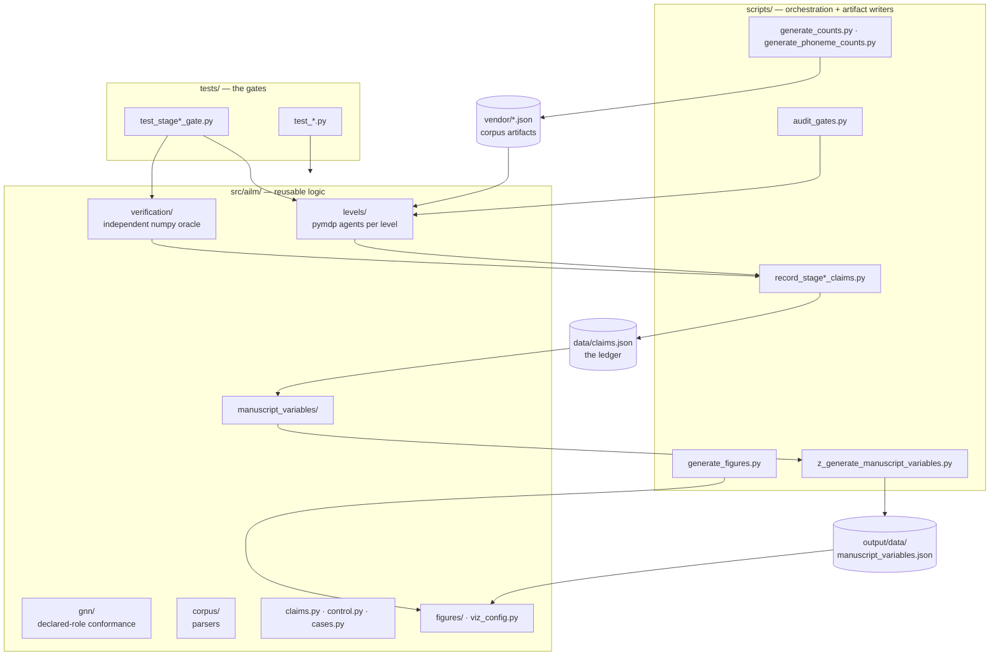

# Code Architecture

Where each kind of logic lives, the enforced dependency direction, and which
module owns which invariant.

**This is not the scientific architecture.** The level hierarchy — what the hidden
factors are, what `A`/`B`/`C`/`D` mean at each level, why L3 uses word identity
× position rather than explicit trie-node states, and which scores use live
inference — is governed by [`hierarchy.md`](hierarchy.md).
[`design/architecture.md`](design/architecture.md) records the design rationale.
The split is deliberate:

- Moving a function, adding a module, or changing an import edits **this** file.
- Changing what a matrix *means* edits **[`design/architecture.md`](design/architecture.md)**.

A change that does both needs both files edited, and the two must agree.

## Runtime and evidence boundaries

The connected Python API and `scripts/run_connected_ailm.py` execute the causal
schedule owned by `ailm.levels.connected`; the [runtime contract](design/connected_runtime.md)
defines its observations, resets and message semantics. Individual level builders,
historical scorers and `ailm.dashboard` retain their separate responsibilities.
The browser dashboard is not a front end for this connected API.

GNN describes and checks each agent's model structure. Python owns inter-agent
scheduling; the connected numerical reference checks individual conditional
updates. The GUM recorder owns the separate frozen evaluation, and the figure
reader authenticates its claims, complete execution inputs and document report.
Neither conformance nor a figure is an additional scientific measurement.
External model probes under `ailm.benchmarks` are comparison instruments, not
components of AILM's pymdp inference graph.

## Three zones



| Zone | Contains | Rule |
|---|---|---|
| `src/ailm/` | Reusable models, parsers, checks, estimands, and figure generators | Standalone. Importable into a bare Python environment with only the declared dependencies. Nothing here imports `infrastructure`; new reusable scientific computation belongs here |
| `scripts/` | Argument parsing, path resolution, I/O, release orchestration, ledger recorders, and generated-artifact writers | Prefer thin orchestration. Bounded recorder-specific estimands may remain beside their sole writers when pure and directly tested; shared computation belongs in `src/ailm/` and is never duplicated across recorders |
| `tests/` | The gates and the unit tests behind them | Real pymdp, real corpora, no mocks. Every metric gate carries a positive **and** a negative control |

Supporting directories: `vendor/` holds the committed, checksummed corpus
artifacts so no test touches the network; `data/claims.json` is the ledger while
`data/literature_search.json`, `data/reference_sources.json`, and
`data/registration_provenance.json` preserve non-measurement evidence;
`docs/manuscript/` holds the authored sections; `output/` is entirely regenerable,
with a committed stable-publication allowlist and ignored transient render
products (see [`output_conventions.md`](reference/output_conventions.md)).

## Package map

The dependency column names the principal relationships a reader needs in order
to navigate the implementation. It is not an exhaustive per-file allowlist; the
normative dependency rules are the whole-package import contract below and its
AST/fresh-process tests.

| Module | Owns | Principal dependencies (not exhaustive) | Exercised by |
|---|---|---|---|
| `ailm/resources.py` | Resolution of vendored artifacts in both a source checkout and an installed wheel. Explicit paths retain precedence; otherwise `importlib.resources` package data is used with a source-tree fallback | importlib.resources, pathlib, stdlib | `tests/test_wheel_resources.py` |
| `ailm/__main__.py` | Entry point for `python -m ailm`; imports and calls `ailm.demo.main` unchanged, so the module form and the `ailm-demo` console script run the identical function | `ailm.demo` | `tests/test_demo.py` |
| `ailm/demo.py` | The offline newcomer demo reachable as `python -m ailm` or `ailm-demo`: prints the committed Stage 1-6 gate-verdict table read straight from `output/reports/gate_audit.json` (one spot cross-check against `data/claims.json` via `ailm.claims.load_ledger`), then runs a live Stage 2B G2P decode of one word through a freshly built `pymdp` agent, printing the full per-position posterior rather than only the argmax. Read-only against committed and vendored data — no network access, no re-measurement, no ledger writes. Needs a source checkout; `output/` and `data/` are not wheel resources | jax, `ailm.levels.letter`, `ailm.levels.phoneme`, `ailm.claims` | `tests/test_demo.py` |
| `ailm/levels/letter.py` | The Stage 1 letter agent: `normalize_text`, `build_letter_transition`, `build_letter_agent`, `compute_perplexity`, `load_brown_counts`, and the `ALPHABET` symbol inventory | pymdp, jax, numpy, stdlib | `tests/test_letter.py`, `tests/test_stage1_gate.py` |
| `ailm/levels/phoneme.py` | The Stage 2 phoneme level, both halves. Part A builds the phone-sequence Agent and exposes both the bounded live path (`compute_phoneme_perplexity`) and the exact sufficient-statistic path used for the canonical full-dictionary claim (`full_corpus_perplexity`); their agreement is checked on a bounded population. Part B builds and runs the live position-aligned letter-to-phone decoder (`build_g2p_emission`, `build_g2p_transition`, `build_g2p_start`, `build_g2p_agent`, `decode_phonemes`, `g2p_accuracy`, `per_letter_argmax_baseline`, and `decode_positions` / `baseline_positions`); the recorder computes the canonical full-set statistics with an independent NumPy decoder only after bounded zero disagreement with this live path | pymdp, jax, numpy, `ailm.levels.letter`, `ailm.corpus.cmudict` | `tests/test_phoneme.py`, `tests/test_phoneme_full_corpus.py`, `tests/test_stage2_gate.py` |
| `ailm/levels/connected_evaluation.py` | Streaming paired document scores and fixed document bootstrap for the local GUM protocol | numpy, connected runtime, authenticated GUM documents | `tests/test_connected_gum.py` |
| `ailm/corpus/connected_gum.py` | Authenticate frozen GUM inputs and parse only raw document text with explicit development-document exclusions | stdlib | `tests/test_connected_gum.py` |
| `ailm/levels/connected_types.py` | Typed raw/structured observations, channel interventions and trace/result contracts | numpy, stdlib | `tests/test_connected.py` |
| `ailm/levels/connected_builder.py` | Assemble GNN-built agents and train-only bridge kernels for connected execution | `ailm.spec_agent`, `ailm.corpus.case_word`, level loaders | `tests/test_connected.py`, `tests/test_wheel_resources.py` |
| `ailm/levels/connected.py` | Causal multirate conditional inference, channel interventions and live-policy next-word generation | pymdp, numpy, connected contracts and model | `tests/test_connected.py`, `tests/test_wheel_resources.py` |
| `ailm/levels/coupling.py` | The L1→L2B soft-observation channel and its sweep: `couple_letter_to_phoneme`, `coupled_positions` / `uncoupled_positions`, `sweep_alpha`, `validate_alpha_grid`, `mcnemar`. Ships gated off at `alpha = 0` — a **recorded negative result**, not an omission (`docs/decisions.md` entry 9, `docs/hierarchy.md`) | numpy, scipy, `ailm.levels.phoneme`, `ailm.verification.oracle` | `tests/test_coupling.py`, `scripts/record_coupling_claims.py`, `scripts/record_channel_predictive_loss_claims.py` (the same channel on the receiver's proper predictive loss, decision 59) |
| `ailm/levels/word.py` | The Stage 3 word level: a two-factor (word identity × position) single-modality model over a bounded lexicon. Its full score uses an exact path identity; a sampled live-pymdp walk verifies that identity | pymdp, jax, numpy, `ailm.config` | `tests/test_stage3_gate.py`, `tests/test_generation.py` |
| `ailm/levels/case.py` | The Stage 4 case level: a single-factor model over the syntactic case roles (UD-derived), observing UPOS only. The full score is a NumPy forward filter; the live-pymdp recursion is compared with it at every held-out position and the agreement is recorded (`scripts/record_pymdp_equivalence_claims.py`, decision 94). Observing `deprel` or `feats[Case]` here is the circularity trap of decision 15 | pymdp, jax, numpy, `ailm.cases`, `ailm.config` | `tests/test_stage4_gate.py`, `tests/test_pymdp_inference_equivalence.py` |
| `ailm/levels/case_czech.py` | The Czech arm of Level 4 (decision 77, exploratory): a duck-typed artifact over UD Czech-PDTC that reuses `ailm.levels.case`'s builders unmodified, scoring the same model against claim:stage4_czech_label_source_morphology_pct% morphological `feats[Case]` labels — the only population where this level reports *accuracy* (`czech_case_accuracy`) rather than agreement | `ailm.levels.case` | `tests/test_czech_case.py`, `scripts/record_czech_case_claims.py`, `scripts/generate_czech_case_counts.py` |
| `ailm/levels/clause.py` | The retained case-only Stage 5 ablation: a joint sentence-type × case-role Agent, an exact closed-form mixture scorer, and the production fixed-seed whole-document-cluster bootstrap over paired-sentence privileged-label gains. The headline score is not a live-pymdp inference path; beside it, the live recursion is compared with the NumPy joint filter on the full held-out set at the posterior level (argmax and joint-posterior tolerance, recorded by `scripts/record_pymdp_equivalence_claims.py`, decision 94), which is posterior agreement rather than score equivalence. The privileged type-label arm is a sensitivity reference, not a hard bound; its current gain is unresolved | pymdp, numpy, `ailm.cases`, `ailm.config` | `tests/test_stage5_gate.py`, `tests/test_pymdp_inference_equivalence.py` |
| `ailm/levels/widened.py` | Canonical widened Level 5: case roles plus VERB/AUX, extraction, add-k Markov fit, authenticated artifact loading and GNN-compatible Agent construction. Shared by connected execution and standalone probe/dashboard paths; their observations and score contracts remain distinct | numpy, `ailm.cases` | `tests/test_widened.py` |
| `ailm/levels/narrative.py` | The Stage 6 document-position model: a tercile-state Agent, the registered observed-position direct conditional scorer, a distinct descriptive live-pymdp sequential predictive scorer, and an independently measured L6→L5 `D`-prior intervention with zero-weight anchor and scrambled control. The two scores are different estimands, and none of these seams forms a connected cascade | pymdp, numpy, `ailm.config`, `ailm.levels.clause` | `tests/test_stage6_gate.py`, `tests/test_pymdp_inference_equivalence.py` |
| `ailm/levels/lexical_channel.py` | The L3 → L2B lexical prefix message into the position-aligned letter-to-phone (G2P) predictive prior and its alpha sweep; recorded to help at the selected interior weight | numpy, stdlib | `tests/test_lexical_channel.py` |
| `ailm/levels/clause_channel.py` | The privileged punctuation-type-oracle → L3 typed word message into the word prior `D[0]` and its alpha sweep. It does not use an L5 posterior. Pre-registered as harmful (decision 27); after the Brown partition correction, both aggregate perplexity and token direction favor the intervention, falsifying harm (decision 88) | numpy, stdlib | `tests/test_clause_word_channel.py` |
| `ailm/case_word_channel.py` | The L4→L3 case-word bridge (protocol P3): the case level's real per-token posterior `q(role \| upos)` — one observation against the reset `D` start, the position-0 behavior of the shipped scorer — asserted row-wise equal, to the module's rounding tolerance, of its closed-form Bayes expression, marginalized into a word message fitted train-only, and inserted into the word prior through the convex mixing of `ailm.levels.clause_channel.mix_prior`. A structural seam: `scripts/evaluate_case_word_channel.py` prints its evaluation report and records nothing | jax, numpy, `ailm.levels.clause_channel` | `tests/test_case_word_channel.py` |
| `ailm/levels/g2p_learning.py` | The latent-state G2P emission-learning experiment of decision 29 — `infer_parameters` where the states are unobserved | jax, numpy, `ailm.levels.phoneme`, `ailm.verification.oracle` | `tests/test_g2p_learning.py` |
| `ailm/levels/online_learning.py` | Online parameter learning on non-stationary text against a frozen control that must lose (decision 28) | numpy, `ailm.levels.letter` | `tests/test_online_learning.py` |
| `ailm/levels/synthetic.py` | The stipulated synthetic letter chain, deterministic corpus generator, independent evaluation-trajectory generator, and order-one comparator used to reduce exact-artifact overlap without asserting external pretraining contents | numpy, `ailm.levels.letter` | `tests/test_synthetic_benchmark.py` |
| `ailm/levels/_stochastic.py` | The one column-stochastic normalizer (`column_stochastic`: counts divided by their axis-0 sums) and the one validator (`validate_column_stochastic`) every level builder shares, so the `[next, current]` orientation is normalized and checked in a single place instead of once per level. The oracle keeps its own copy by contract | numpy | `tests/test_coupling.py`, `tests/test_phoneme.py` |
| `ailm/verification/connected_provenance.py` | Complete execution-input inventory shared by the connected recorder and figure; authenticates exact regular source and artifact files without model inference | stdlib | `tests/test_connected_provenance.py`, `tests/test_connected_gum.py`, `tests/test_figures_connected.py` |
| `ailm/verification/oracle.py` | The closed-form HMM instrument: `forward_filter`, `forward_backward`, `viterbi`, `sequence_perplexity`, `markov_chain_perplexity`, `identity_emission`, `word_path_logprob` | **numpy and stdlib only** | `tests/test_oracle.py`, `tests/test_oracle_independence.py`, `tests/test_stage2_gate.py` |
| `ailm/generation.py` | The independent L3→L1g generation seam: next-letter policy selection with lexicon `C` and Brown-bigram habit `E`, scored against gamma-sweep and scrambled-`C` controls. L6 and L5 are absent from this run | pymdp, jax, numpy, `ailm.levels.letter` | `tests/test_generation.py` |
| `ailm/learning.py` | Parameter learning inside pymdp — `infer_parameters` as conjugate counting, and the agreement identity against an external count (decisions 22–23) | pymdp, numpy, `ailm.levels.letter` | `tests/test_learning.py` |
| `ailm/complexity.py` | Per-level operation and byte counts — exact arithmetic, never timings (decision 21). Computes `eq:step_cost` | numpy, stdlib | `tests/test_complexity.py` |
| `ailm/parameters.py` | Three counts per array — **stored**, **nonzero**, **free** — because one number misleads in three different directions: stored is what memory costs, nonzero is what the model actually uses, and free is what the simplex constraint leaves after removing one degree of freedom per distribution. Also binds each level to its GNN spec via `GNN_SPEC_FILES` and `check_model_against_gnn` | numpy, `ailm.gnn` | `tests/test_parameters.py` |
| `ailm/call_cache.py` | An append-only, content-addressed store of observed external-model replies, keyed by the immutable model digest, endpoint, cache-purpose protocol, and complete request. Its unkeyed digests provide integrity/self-consistency checks inside a trusted-local writer boundary, not hostile-writer authentication. A key identifies a replayable snapshot; it does **not** assert that temperature-zero serving is pure or independent of server history. The harness discards the first post-load/workload call; makes both repeat-agreement trials fresh while persisting them under distinct purpose protocols; and re-queries a stratified cache sample for drift. Only an unterminated malformed final append is recoverable; interior or terminated malformed JSON and invalid complete records fail closed. Lives in `cache/`, not `output/`: it cannot be rebuilt without a live model server, and the release profile's coverage floor depends on it | hashlib, stdlib | `tests/test_call_cache.py`, `tests/test_external_benchmark_provenance.py`, `tests/test_release_orchestration.py` |
| `ailm/replay_provenance.py` | The fail-closed complement to hermetic recorder replay: discovers every recorder that imports a server entry point and binds its complete ledger namespace to the current implementation/vendor/lock manifest, canonical run configuration, model-tag-to-identity pairs, and exact validated call records. A recorder-specific semantic validator must then reproduce every bound claim from those records. Receipt digests share the cache's trusted-local, unkeyed integrity boundary | `ailm.call_cache`, hashlib, ast, stdlib | `tests/test_replay_provenance.py`, `tests/test_external_benchmark_provenance.py`, `tests/test_release_orchestration.py` |
| `ailm/publication_derivative.py` | Parse reviewed publication contracts and authenticate exact original/current source and evidence identities; keep historical measurement validation strict and return separately typed derivative results | stdlib | `tests/test_publication_derivative.py`, `tests/test_release_orchestration.py` |
| `ailm/_publication_types.py` | Reviewed derivative schemas, frozen values and strict primitive parsing | stdlib | `tests/test_publication_derivative.py` |
| `ailm/_publication_inventory.py` | Regular-file, Git and filesystem source identities | stdlib | `tests/test_publication_derivative.py` |
| `ailm/_publication_contract.py` | Strict declaration and externally reviewed finite-support contract loading | stdlib | `tests/test_publication_derivative.py` |
| `ailm/_publication_proof.py` | Authenticate retained real execution reports and original module origins | stdlib | `tests/test_publication_derivative.py` |
| `ailm/_publication_attestation.py` | Parse derivative evidence and require complete offline/live acceptance predicates | stdlib | `tests/test_publication_derivative.py` |
| `ailm/loopback_http.py` | Fail-closed HTTP JSON transport for local model probes: origin-only loopback endpoints, proxy bypass, refused redirects, JSON content type, and bounded response bodies | `urllib` (stdlib) | `tests/test_loopback_http.py` |
| `ailm/reference_presentation.py` | Stdlib-only canonical deposited-source identities, physical locators and stable local protocol destinations, shared by manuscript and documentation hydration; no network access or model imports | `ailm.value_formatting`, stdlib | `tests/test_reference_docs.py`, `tests/test_reference_source_fidelity.py` |
| `ailm/supporting_package.py` | Finite source-context mapping for the whole protocol companion and complete relocated HTML link, fragment and asset validation; actual provider IDs remain authoritative | stdlib | `tests/test_supporting_package.py` |
| `ailm/reference_sources.py` | Explicitly opt-in live revalidation of the committed deposited-source snapshot: exact-version Zenodo metadata, strict official URL identity, bounded full-file authentication with both recorded digests, and optional Poppler page-extent verification. The private non-production origin seam accepts only loopback IP literals so real HTTP controls remain offline | requests, `ailm.corpus._download`, stdlib | `tests/test_reference_source_live.py`, `tests/test_reference_source_fidelity.py` |
| `ailm/clustering.py` | Cluster-aware inference for paired comparisons whose observations nest. `statistics.py` treats every matched pair as independent, which the exact McNemar and sign tests require and a corpus of sentences-within-documents violates | scipy, numpy, `ailm.statistics` | `tests/test_clustering.py` |
| `ailm/benchmarks/` | The external reference-frame probe against the local Ollama server and the hosted OpenRouter transport, with its protocol constraints (decision 30). An external probe only; no neural model is part of AILM's stack | `urllib` (stdlib), numpy, `ailm.levels.letter`, `ailm.levels.phoneme`, `ailm.statistics` | `tests/test_benchmarks.py`, `tests/test_synthetic_benchmark.py` |
| `ailm/benchmarks/constants.py` | Shared seeds, windows and thresholds, so no two arms can disagree about them | stdlib | `tests/test_benchmarks.py` |
| `ailm/benchmarks/synthetic_protocol.py` | Frozen, code-owned no-demonstration and in-context synthetic measurement contracts: populations, independent-position generator, query/example widths, response/context bounds, arm order, warm-up, and cache protocols | `ailm.benchmarks.constants`, `ailm.levels.synthetic` | `tests/test_synthetic_benchmark.py`, `tests/test_incontext_benchmark.py` |
| `ailm/benchmarks/aligned_g2p.py` | The stipulated aligned spelling-to-pronunciation artifact (protocol P2, design B): a stipulated, recorded, digested per-letter correspondence onto the canonical phone inventory, pair splits cut from independently seeded trajectories of the shipped stipulated letter chain, the shipped G2P engine refit on the stipulated train pairs as the native comparator, and the probe prompt/payload seam. It is deliberately not an English letter-to-phone reading and is never called contamination-free | numpy, stdlib, `ailm.levels.phoneme`, `ailm.levels.synthetic`, `ailm.benchmarks.comparators`, `ailm.benchmarks.prompts` | `tests/test_synthetic_aligned_g2p.py` |
| `ailm/benchmarks/fitted/` | The fitted-probe data/identity foundation: a separate experimental surface that never enters `ailm.benchmarks.constants.SERVED_PROBES`, touches no historical bench namespace, downloads nothing, and trains nothing | `ailm.benchmarks.constants`, stdlib | `tests/test_fitted_probe_foundation.py` |
| `ailm/benchmarks/fitted/census.py` | Streaming exact-census counting for the fitted-probe fitting objective: supervised targets and conditioning contexts tracked separately, both exact, the occurrence multiset always reconciling to the target total; plus `stride_aliasing_demo`, the checkable refutation that a strided sample preserves bigram relative frequencies | stdlib | `tests/test_fitted_probe_foundation.py` |
| `ailm/benchmarks/fitted/data.py` | Deterministic dataset builders for the declared letter/phoneme/G2P fitting sources: instance construction with positional order preserved, the diagnostic tail carve behind a declared seam gap, the comparator's fit-region-only refit counts, and phoneme windows shaped to the scored task. Level helpers are imported lazily at call time; nothing downloads or trains | `ailm.levels.letter`, `ailm.levels.phoneme` (lazy), stdlib | `tests/test_fitted_probe_foundation.py` |
| `ailm/benchmarks/fitted/identity.py` | The strict fitted-model identity schema: `FITTED_PROBES` (a separate registry, empty until a fit registers), `validate_fitted_probes`, and `build_lineage_chain` — five ordered sha256 digest stages binding upstream revision, adapter, fused model, converted artifact, and served tag. Lineage is digests only; no behavioral agreement and no model inspection is claimed | `ailm.benchmarks.constants`, stdlib | `tests/test_fitted_probe_foundation.py` |
| `ailm/benchmarks/fitted/receipt.py` | `DataReceipt` — the immutable, write-once binding of one generated dataset to its exact counts, declared policy, source bindings, file digests, and separation arithmetic, verifiable by recomputing every digest — and `CheckpointSpec`, the contract a later isolated trainer binds its adapter run to | `ailm.benchmarks.fitted.identity`, stdlib | `tests/test_fitted_probe_foundation.py` |
| `ailm/benchmarks/prompts.py` | Position sampling and the prompt strings handed to an external model | stdlib | `tests/test_benchmarks.py` |
| `ailm/benchmarks/scoring.py` | Interval estimates, paired tests and proper scores over benchmark answers | `ailm.statistics` | `tests/test_benchmarks.py` |
| `ailm/benchmarks/ollama.py` | Transport to a local Ollama server through the loopback-only, proxy-free HTTP boundary, with the content-addressed call cache | `ailm.loopback_http`, `ailm.call_cache` | `tests/test_call_cache.py`, `tests/test_loopback_http.py` |
| `ailm/benchmarks/openrouter_budget.py` | Process-shared worst-case request reservations and explicit charge reconciliation for capped hosted runs | decimal, stdlib file locking | `tests/test_openrouter_client_contracts.py` |
| `ailm/benchmarks/openrouter.py` | Transport to OpenRouter's hosted models through the OpenAI-compatible chat completions API, with the content-addressed call cache | `ailm.call_cache` | — |
| `ailm/benchmarks/corpora.py` | Drawing evaluation positions out of the vendored corpora | `ailm.levels.letter`, `ailm.levels.phoneme` | `tests/test_benchmarks.py` |
| `ailm/benchmarks/comparators.py` | This project's own decoders, scored on the same positions as the external models | `ailm.levels.*` | `tests/test_benchmarks.py` |
| `ailm/benchmarks/calibration.py` | Reconstructing a distribution from truncated top-k mass, and the floor that creates | numpy | `tests/test_calibration_floor.py` |
| `ailm/benchmarks/harness.py` | Running a whole benchmark: replicates, agreement, per-bucket metrics | the modules above | `tests/test_benchmarks.py` |
| `ailm/evaluation.py` | The canonical Stage 1 evaluation protocol fixture: immutable text, version, SHA-256, byte extent, repetition count, source, license, and fail-closed identity validation shared by gates, recorders, and benchmarks; also the exact all-position order-1 bound including the fixed initial prediction | `ailm.levels.letter` (local scoring import), stdlib | `tests/test_evaluation_fixture.py`, `tests/test_evaluation_population_bound.py`, `tests/test_stage1_gate.py` |
| `ailm/statistics.py` | The repository-wide multiplicity family, exact power, and confidence intervals as executable contracts rather than prose | scipy, numpy, stdlib | `tests/test_statistics.py`, `tests/test_stage6_gate.py` |
| `ailm/gates.py` | **The single gate classifier.** `gate_passes`, `gate_margin`, `classify_gate`, `evaluate_gate`, `GateVerdict`, `GateId` — fail-closed semantics shared by the audit and the figure, so a verdict has exactly one implementation | stdlib | `tests/test_gates.py`, `tests/test_control_meta_validation.py` |
| `ailm/cuda12_status.py` | Runtime status probe for the opt-in `cuda12` dependency extra: structured backend report with an explicit "absent" outcome on CPU-only environments, never importing CUDA packages unconditionally (commit gpuenable) | stdlib | `tests/test_cuda12_status.py` |
| `ailm/channel_registry.py` | The canonical inventory and evidence rule for every measured inter-level channel. `channel_by_key` rejects duplicate keys, duplicate evidence rules, and incomplete records before prose, figures, or classifiers consume them | stdlib | `tests/test_docs_hydration.py` |
| `ailm/channels.py` | The complete source × insertion-site channel factorial. It dispatches into shipped level primitives, transports messages between the letter and phoneme alphabets, and gates the diagonal cells against the original per-position outputs before evaluating the off-diagonal cells | numpy, `ailm.levels.coupling`, `ailm.levels.lexical_channel` | `tests/test_channel_factorial.py`, `tests/test_channel_proper_loss_claims.py` |
| `ailm/config.py` | Tunable hyperparameters for the level builders, with consumption tests so a knob nothing reads cannot survive (decision 11) | stdlib | `tests/test_config.py` |
| `ailm/template_root.py` | The explicit sources for the `docxology/template` checkout location, `TEMPLATE_REPO_ROOT` then the per-machine `.template-root` file, shared by manuscript hydration, the figure registry and (restated stdlib-only) the release verifier, each of which validates the result itself | stdlib | `tests/test_figure_registry.py`, `tests/test_release_orchestration.py` |
| `ailm/ledger_lock.py` | Single-writer mutual exclusion for `data/claims.json`: `ledger_lock_path`, `single_writer_lock`, `holder_is_alive`. The ledger is read and rewritten whole, so two concurrent recorders would silently lose one's writes | stdlib | `tests/test_benchmarks.py` |
| `ailm/spec_agent.py` | `build_agent_from_spec` — builds every shipped level from its GNN spec alone, bit-identical to the builder path (decision 20) | pymdp, numpy, `ailm.gnn` | `tests/test_spec_agent.py` |
| `ailm/speech_boundary.py` | The Stage 7 interface contract: where DSP ends and pymdp begins. An interface, not a level | stdlib, `ailm.levels.phoneme` | `tests/test_speech_boundary.py` |
| `ailm/gnn/` | Conformance of a live agent against a declarative GNN spec — pins each matrix by its *declared semantic role* and its structural form (`Identity(n)`, `Uniform(n)`, `Learned(...)`), which is what a purely dimensional check cannot do | numpy, stdlib | `tests/test_gnn_conformance.py`, `tests/test_gnn_registry.py` |
| `ailm/gnn/types.py` | Errors, section names, the parsed-spec dataclasses — the vocabulary the rest of the package speaks | stdlib | `tests/test_gnn_conformance.py` |
| `ailm/gnn/parsing.py` | GNN source text to a `GnnSpec`. Never touches a live agent, so a spec is readable with no pymdp in reach | stdlib | `tests/test_gnn_conformance.py` |
| `ailm/gnn/shapes.py` | A live agent's canonical dimensions, without judging them | numpy | `tests/test_gnn_conformance.py` |
| `ailm/gnn/declarations.py` | What a spec says about itself, checked without building anything — an incoherent declaration is caught before any model is compared against it | `ailm.gnn.shapes`, `ailm.gnn.types` | `tests/test_gnn_conformance.py` |
| `ailm/gnn/live.py` | A built agent against the spec that declares it: every way the two disagree while each looks reasonable. A transposed transition is still a valid stochastic matrix | numpy, `ailm.gnn.declarations`, `ailm.gnn.parsing`, `ailm.gnn.shapes` | `tests/test_gnn_conformance.py` |
| `ailm/gnn/conformance.py` | The entry point and nothing else — collects both families of check, and turns a non-empty report into a raise | `ailm.gnn.declarations`, `ailm.gnn.live` | `tests/test_gnn_conformance.py` |
| `ailm/gnn/registry.py` | Which specs exist under `gnn/models/`, and where. `spec_dir` resolves packaged canonical specs or walks up to the source root | `ailm.gnn.parsing` | `tests/test_gnn_registry.py` |
| `ailm/corpus/cmudict.py` | CMUdict parsing and the canonical ARPAbet inventory, including the comment-stripping trap | requests, stdlib | `tests/test_cmudict.py`, `tests/test_cmudict_load.py` |
| `ailm/corpus/ud.py` | UD English EWT parsing, the deprel-derived case oracle (a research claim, not ground truth), and `build_upos_lexicon` — the most-frequent-tag-per-form lexicon anything asking UD for a part of speech shares | requests, `ailm.cases`, stdlib | `tests/test_ud.py` |
| `ailm/corpus/case_word.py` | The case-word (L4→L3) bridge artifact: one `(word_form, upos, case_label_or_null, label_source)` row per EWT dev token, on the same document-index stride split as the shipped case artifact and cross-validated against its recorded split indices at build and load. The oracle case label is a sender-side fitting input recorded with its route; it is structurally unavailable to any model observation | `ailm.corpus.ud`, `ailm.cases`, stdlib | `tests/test_corpus_case_word.py` |
| `ailm/corpus/_download.py` | shared non-network boundary for strict response framing, bounded incremental hashing, and durable atomic publication of authenticated raw-corpus bytes | requests response types, stdlib | `tests/test_corpus_download.py`, `tests/test_cmudict_load.py`, `tests/test_ud.py` |
| `ailm/corpus/brown.py` | The immutable NLTK Brown archive identity, bounded byte/ZIP validation, exact-source resolution, direct verified-archive reader, unambiguous document/category digests, and revision-bound category-stratified whole-document partition; canonical generation has no fallback | nltk, stdlib | `tests/test_corpus_source_integrity.py`, `tests/test_provenance_checksums.py`, `tests/test_letter.py`, `tests/test_stage3_gate.py` |
| `ailm/corpus/ud_czech.py` | The immutable two-shard UD Czech-PDTC source contract: exact train-ft/dev filenames, revision, URLs, byte extents, SHA-256 digests, and artifact-provenance validation | stdlib | `tests/test_corpus_source_integrity.py`, `tests/test_czech_case.py`, `tests/test_provenance_checksums.py` |
| `ailm/cases.py` | Distinct linguistic and scoped CEREBRUM function roles; the exact [Supplement {{CEREBRUM_POMDP_SUPPLEMENT}}]({{CEREBRUM_POMDP_SUPPLEMENT_URL}}) tuple; AILM's explicitly project-owned pymdp crosswalk; source-faithful per-case formulation metadata; and the implemented-but-inert NOM/ACC scalar scaffold | numpy, stdlib | `tests/test_cases.py`, `tests/test_reference_source_fidelity.py` |
| `ailm/claims.py` | `ClaimsLedger`, `load_ledger`, `scan_prose` — the ledger and the prose scanner | stdlib | `tests/test_claims_ledger.py`, `tests/test_claims_discipline.py` |
| `ailm/formal_inventory.py` | Shared bounded Lean declaration scan, deterministic axiom-driver generation, and per-module theorem counts; compilation and report coverage remain separate checks | stdlib | `tests/test_formal_isomorphism.py` |
| `ailm/value_formatting.py` | Shared ledger-value formatter and manuscript-variable base error, re-exported by the token generator; preserves recorded precision without importing the numerical stack | stdlib | `tests/test_manuscript_variables.py`, `tests/test_docs_hydration.py` |
| `ailm/docs_hydration.py` | Documentation numbers in both directions: `hydrate` resolves every `claim:<label>` and canonical source-reference token for the mirror under `output/docs/`, and `find_hardcoded_values` reports the reverse mistake — a distinctive numeral in prose that exactly equals a recorded claim, which is a copy that will drift | `ailm.value_formatting` | `tests/test_docs_hydration.py` |
| `ailm/control.py` | `ControlHarness`, `GateVacuousError` — the positive/negative control protocol | stdlib | `tests/test_control_harness.py` |
| `ailm/comparators.py` | `fit_left_context_lookup`, `deranged_lookup` — the strongest member of the comparator class, searched rather than assumed (decision 69). A first-order lookup over *observed* symbols only, with no latent state; it is what shows the gate check is not yet a procedure ([@sec:comparator_strength]) | stdlib | `tests/test_comparators.py` |
| `ailm/generative/smoke.py` | Verification that the installed pymdp has the API surface AILM depends on: `A_dependencies` shape, `update_empirical_prior`, absence of `update_A`, `infer_policies` output shape | pymdp, jax, numpy | `tests/test_pymdp_smoke.py`, `tests/test_stage0_gate.py` |
| `ailm/manuscript_variables/__init__.py` | The `{{TOKEN}}` map, a package whose `__init__` re-exports every public name so `from ailm.manuscript_variables import X` is unchanged: `MissingClaimError`; `generate_manuscript_variables` as an orchestrator over one `_produce_<section>(variables, ...)` writer per `# ──` section, each writing by subscript into the parameter the ledger-shadow guard scans; the `_ClaimReaders` helper binding the four claims-reading closures the sections share; `_SyntheticSweep`, `_ContextReconciliation`, and `_LexicalSweep` typed records carrying cross-section state; and derived render-time values. It re-exports `REQUIRED_CLAIMS` for compatibility but does not own the list | pyyaml, stdlib, `ailm.required_claims` | `tests/test_manuscript_variables.py`, `tests/test_manuscript_tokens.py` |
| `ailm/manuscript_variables/_core.py` | Ledger tokens, derived quantities, paper metadata, and the `generate_manuscript_variables` orchestrator | stdlib, package siblings | `tests/test_manuscript_variables.py` |
| `ailm/manuscript_variables/_claims.py` | `_ClaimReaders`, claim reading, numeric-domain validation, and claim-shape helpers | stdlib, package siblings | `tests/test_manuscript_variables.py` |
| `ailm/manuscript_variables/_io.py` | JSON/YAML loading, the duplicate-key-refusing YAML loader, and the duplicate-checked variable map | stdlib, package siblings | `tests/test_manuscript_variables.py` |
| `ailm/manuscript_variables/_formatting.py` | Prose-formatting helpers: counts, ordinals, timestamps, clauses | stdlib, package siblings | `tests/test_manuscript_variables.py` |
| `ailm/manuscript_variables/_exceptions.py` | Exception types for manuscript-variable generation | stdlib, package siblings | `tests/test_manuscript_variables.py` |
| `ailm/manuscript_variables/_channels.py` | Cross-level channel classification and qualification helpers | stdlib, package siblings | `tests/test_manuscript_variables.py` |
| `ailm/manuscript_variables/_stats.py` | Paired-count power and bound statistics shared by several producers | stdlib, package siblings | `tests/test_manuscript_variables.py` |
| `ailm/manuscript_variables/literature.py` | Project-file loaders: claims, config, literature, references, literals, vendor metadata | stdlib, package siblings | `tests/test_manuscript_variables.py` |
| `ailm/manuscript_variables/synthetic.py` | Synthetic and aligned-G2P benchmark producers (accessory external-probe arms) | stdlib, package siblings | `tests/test_manuscript_variables.py` |
| `ailm/manuscript_variables/connected.py` | Reconcile connected GUM counts, paired loss, uncertainty direction, protocol identity and OOV disclosure before emitting neutral prose tokens | connected protocol constants, package readers | `tests/test_connected_manuscript.py` |
| `ailm/manuscript_variables/context.py` | In-context benchmark protocol and results producers (accessory external-probe arms) | stdlib, package siblings | `tests/test_manuscript_variables.py` |
| `ailm/manuscript_variables/architecture.py` | Calibration, lexical-sweep, fitted/Stage 5, and architecture-tally producers | stdlib, package siblings | `tests/test_manuscript_variables.py` |
| `ailm/manuscript_variables/null_bounds.py` | Derived-power and null-bound producers | stdlib, package siblings | `tests/test_manuscript_variables.py` |
| `ailm/manuscript_variables/scaling.py` | Stage 3 scaling-ladder producer | stdlib, package siblings | `tests/test_manuscript_variables.py` |
| `ailm/manuscript_contract.py` | The fail-closed authored-to-resolved boundary: canonical token grammar, source coverage, hard-coded variable detection, exact file inventory, independent substitution, and post-injection drift/unresolved checks | stdlib; runtime validation delegates quantitative Markdown classification to `ailm.claims` | `tests/test_manuscript_tokens.py` |
| `ailm/required_claims.py` | The ledger labels a render may not proceed without. Data, not logic: it was 955 of `manuscript_variables.py`'s 1,518 lines and buried the hydration machinery under a list | stdlib | `tests/test_manuscript_variables.py` |
| `ailm/dashboard/config.py` | Every dashboard tunable, one default each, overridable by `AILM_DASHBOARD_<FIELD>`; refuses a value that does not parse rather than defaulting it | stdlib | `tests/test_dashboard.py` |
| `ailm/dashboard/engine.py` | Level-specific NumPy/exact traces over arbitrary text, the separate L3→L1g policy rollout, and `converse()` for one chat turn. The dashboard is an explanatory orchestration, not evidence that the recorded L3-L6 scores ran through pymdp or that all levels form one cascade | numpy, `ailm.levels.*` | `tests/test_dashboard.py` |
| `ailm/dashboard/server.py` | Four endpoints and the static tree. `GET /api/config` serves the object the server enforces requests against, so no bound is written twice | stdlib | `tests/test_dashboard.py` |
| `ailm/dashboard/capture.py` | The manuscript capture receipt: the served-route table every capture must cover and the byte, decoded-pixel and served-asset bindings that make a browser raster evidence. `scripts/capture_dashboard.py` assembles a receipt from the browser's environment; `ailm.figures.dashboard_observation` validates it from the project's | stdlib | `tests/test_dashboard_capture.py`, `tests/test_figures_dashboard_observation.py` |
| `ailm/dashboard/__main__.py` | The `python -m ailm.dashboard [port] [host]` boundary: resolves CLI arguments over one validated configuration, enforces a loopback bind, and reports invalid input without opening a socket | stdlib, `ailm.dashboard.config`, `ailm.dashboard.server` | `tests/test_dashboard.py` |
| `ailm/dashboard/static/` | Markup, one stylesheet, nine native ES modules. No build step and no external assets; `main.js` attaches inline-handler functions to `window` because modules do not populate it | none | `tests/test_dashboard.py` |
| `ailm/viz_config.py` | The palette (Okabe–Ito, colorblind-safe), the type scale, canvas sizes, and `MIN_FONT_PT` — the legibility floor | matplotlib | `tests/test_figures_architecture.py`, `tests/test_figures_results.py` |
| `ailm/figures/_common.py` | Deterministic PNG writing, the legibility and canvas-overflow assertions, and loading the token map | matplotlib, stdlib | `tests/test_figure_layout.py`, `tests/test_figures_architecture.py` |
| `ailm/figures/architecture.py` | `fig:hierarchy`, `fig:inference_cycle` — pure functions of the code's own constants, no measured number | matplotlib, `ailm.levels.*`, `ailm.cases` | `tests/test_figures_architecture.py` |
| `ailm/figures/matrices.py` | `fig:letter_transition`, `fig:wiring_comparison`, `fig:phoneme_matrices` | matplotlib, numpy, `ailm.levels.letter` | `tests/test_figures_architecture.py`, `tests/test_figure_layout.py` |
| `ailm/figures/results.py` | `fig:perplexity_ladder`, `fig:information_ceiling`, `fig:g2p_accuracy`, and the ledger cross-check identities each one must satisfy | matplotlib, `ailm.figures._common` | `tests/test_figures_results.py`, `tests/test_figure_layout.py` |
| `ailm/figures/gates.py` | `fig:gate_taxonomy`, `fig:subsample_bias`. Its `_classify` is a thin wrapper over `ailm.gates.classify_gate`, the same function `scripts/audit_gates.py` reaches through `ailm.gates.evaluate_gate`, so figure and audit cannot disagree — there is one classifier, not two mirrored copies | matplotlib, `ailm.gates`, `ailm.figures.results` | `tests/test_figures_results.py`, `tests/test_figure_layout.py` |
| `ailm/figures/calibration_floor.py` | `fig:calibration_floor` — where the external benchmark's captured-mass floor belongs, from one offline sweep of AILM's own letter-transition columns | matplotlib, `ailm.figures._common` | `tests/test_calibration_floor.py`, `tests/test_figure_layout.py` |
| `ailm/figures/incontext_sweep.py` | `fig:incontext_sweep` — how every registered probe responds to labeled one-transition examples and their character-level mapping derangement; this bounds one prompt-format remediation without resolving the broader fitted-versus-unfitted asymmetry | matplotlib, `ailm.figures._common`, `ailm.benchmarks.synthetic_protocol` | `tests/test_figures_results.py`, `tests/test_figure_layout.py` |
| `ailm/figures/null_bounds.py` | `fig:null_bounds` — every null in the paper drawn as a **bound** rather than an absence, read from the ledger and the derived interval tokens so no panel can drift from its measurement | matplotlib, `ailm.figures._common` | `tests/test_figures_results.py`, `tests/test_figure_layout.py` |
| `ailm/figures/scaling_ladder.py` | `fig:scaling_ladder` — the word level's coverage/perplexity trade across lexicon size, where the two quantities move in opposite directions | matplotlib, `ailm.figures._common` | `tests/test_figures_results.py`, `tests/test_figure_layout.py` |
| `ailm/figures/composition.py` | `fig:gnn_pipeline`, `fig:composition` — the spec-to-agent loop and the composition seam, with dimensions read from the GNN specs at generation time | matplotlib, `ailm.gnn` | `tests/test_figures_composition.py`, `tests/test_figure_layout.py` |
| `ailm/figures/composition_results.py` | `fig:word_miswirings`, `fig:case_both_defects`, `fig:generation_sweep`, `fig:channel_comparison` | matplotlib, `ailm.figures._common` | `tests/test_figure_layout.py`, `tests/test_caption_standard.py` |
| `ailm/figures/interpretability.py` | `fig:case_matrices`, `fig:word_matrices`, `fig:trie_narrowing` — parameters shown as readable conditional probabilities, the interpretability claim demonstrated rather than asserted (decision 31) | matplotlib, numpy, `ailm.viz_config` | `tests/test_figure_layout.py`, `tests/test_caption_standard.py` |
| `ailm/figures/levels56.py` | `fig:clause_null`, `fig:narrative_channel` | matplotlib, `ailm.figures._common` | `tests/test_figure_layout.py` |
| `ailm/figures/inference_evidence.py` | `fig:inference_evidence` — what each upper-level score is and what kind of evidence backs it, drawn only from recorded equivalence tokens | matplotlib, `ailm.figures._common` | `tests/test_figures_inference_evidence.py`, `tests/test_figure_layout.py` |
| `ailm/figures/learning.py` | `fig:learning_agreement` — learning-equals-counting (decisions 22–23) | matplotlib, `ailm.figures._common` | `tests/test_figure_layout.py` |
| `ailm/figures/complexity.py` | `fig:complexity_ops`, `fig:complexity_memory` | matplotlib, `ailm.complexity` | `tests/test_figure_layout.py` |
| `ailm/figures/dashboard_observation.py` | `fig:dashboard_observation` — authenticated warm browser capture; verifies PNG bytes, decoded pixels, and served-source bindings before framing the original raster | matplotlib, Pillow, NumPy, capture receipt | `tests/test_figures_dashboard_observation.py`, `tests/test_figure_layout.py` |
| `ailm/figures/connected.py` | `fig:connected_core` — runtime-derived causal channels and the report-bound paired GUM character-loss gain; refuses missing or inconsistent source, claims and document summaries | matplotlib, connected channel contract, typed manuscript claim reader, registered document bootstrap | `tests/test_figures_connected.py`, `tests/test_figure_layout.py` |
| `ailm/figures/confirmatory.py` | `fig:confirmatory_replication` — the held-back replication, its controls, and Level 6's clustered estimand on both populations | matplotlib, `ailm.statistics` | `tests/test_figures_confirmatory.py`, `tests/test_figure_layout.py` |
| `ailm/figures/multiplicity.py` | `fig:multiplicity_forest` — the multiplicity family with the Stage 6 fragility strip | matplotlib, `ailm.statistics` | `tests/test_figures_multiplicity.py`, `tests/test_figure_layout.py` |
| `ailm/figures/benchmarks.py` | `fig:external_benchmarks` — sourced only from ledger tokens, never from a live probe | matplotlib, `ailm.figures._common` | `tests/test_figures_results.py`, `tests/test_figure_layout.py` |
| `ailm/figures/belief_dynamics.py` | `fig:belief_dynamics` — one sentence traced through the real inference stack | matplotlib, `ailm.levels.*` | `tests/test_figure_layout.py` |
| `ailm/figures/samples.py` | `fig:generation_samples` — real generated output, not a summary statistic of it | matplotlib, `ailm.generation` | `tests/test_figure_layout.py` |
| `ailm/figures/aligned_g2p.py` | `fig:aligned_g2p_arms` — the P2 stipulated aligned spelling-to-pronunciation comparator arms, with Wilson intervals derived at render time from the recorded accuracies and denominators (decision 101) and the tie verdict read from the recorded boolean (decision 116) | matplotlib, `ailm.figures._common`, `ailm.benchmarks.scoring` | `tests/test_figure_layout.py` |
| `ailm/figures/case_word_sweep.py` | `fig:case_word_sweep` — the decision-121 case-word bridge influence sweep, its grid discovered by token prefix scan, the clustered interval drawn around the per-emission effect and never around the per-token mean | matplotlib, `ailm.figures._common` | `tests/test_figure_layout.py` |
| `ailm/figures/level_gate_summary.py` | One panel comparing every built level's shipped model against its own baseline (0) and ceiling (1) on a single shared axis, with the four raw numbers (baseline, model, ceiling, ceiling type) and the verdict drawn beside each row as the audit trail for the fraction. Reclassifies every row through `ailm.gates.classify_gate` against `output/reports/gate_audit.json` and cross-checks the result against `ailm.figures.architecture.LEVELS`, raising rather than drawing a silently stale or contradictory verdict | matplotlib, `ailm.gates`, `ailm.figures._common`, `ailm.figures.architecture` | `tests/test_figures_level_gate_summary.py` |

Each package additionally carries its own `README.md` and `AGENTS.md` beside the
code — read those before editing inside a package.

## Import contract

```text
scripts/            ──→ src/ailm/            (prefer orchestration; recorder-specific estimands are bounded)
tests/              ──→ src/ailm/            (direct testing)
src/ailm/levels/    ──→ pymdp, jax, numpy
src/ailm/channels.py ──→ src/ailm/levels/ (dispatches; never reimplements a filter)
src/ailm/figures/   ──→ matplotlib, src/ailm/levels, output/data token map
src/ailm/verification/oracle.py ──→ numpy ONLY
src/ailm/           ──X  infrastructure      (never)
src/ailm/verification/oracle.py ──X pymdp, jax  (never)
```

No arrow points upward, and two arrows are explicitly forbidden.

### The oracle must never import pymdp or jax

`ailm/verification/oracle.py` is an *independent instrument*. Its entire value is
that it was written separately from the thing it audits. A throwaway version of it
is what caught Stage 1's wiring bug — a hand-rolled numpy Markov chain whose
perplexity disagreed with what the mis-wired pymdp agent reported, by roughly the
whole distance between claim:stage1_letter_perplexity (correct wiring) and
claim:stage1_anti_informative_perplexity (the swap). If the oracle shared code with
pymdp it would inherit the flaw it exists to detect.

Its array conventions are pinned in the module docstring and a transpose there
silently invalidates every cross-check in the project: `emission[i, j] = P(obs=i |
state=j)` with shape `(n_obs, n_states)`; `transition[i, j] = P(next=i | cur=j)`
with shape `(n_states, n_states)`; both column-stochastic; `start` is the
distribution over `state_0` *before* any observation, so the predictive
distribution at `t = 0` is `start` itself and the transition is not applied first.

### `src/` must never import `infrastructure`

The template repository's `infrastructure` package is available at render time and
at no other time. `src/ailm/` has to work in a bare checkout, so
`manuscript_variables.py` reads `SOURCE_DATE_EPOCH` from the environment directly
rather than borrowing a helper, and the figure modules do their own deterministic
PNG writing. The single point where `infrastructure` legitimately enters is
`scripts/z_generate_manuscript_variables.py`, which imports
`infrastructure.rendering.manuscript_injection` *after* resolving the template root
— see [`rendering_pipeline.md`](method/rendering_pipeline.md).

**The rule is a boundary, not a wall: scripts may import `infrastructure`, and
two do.** `scripts/z_generate_manuscript_variables.py` imports
`infrastructure.rendering.manuscript_injection`, and
`scripts/generate_figure_registry.py` imports
`infrastructure.documentation.build_generated_figure_registry` and
`write_generated_figure_registry` to publish
`output/figures/figure_registry.json`. Both resolve the template root the same
way — `TEMPLATE_REPO_ROOT`, then a walk-up, then the conventional sibling
checkout — because two different answers to "where is the template" would be a
defect waiting to happen.

The registry is *built by the template's own function* rather than hand-written
from the outside. The envelope's shape is defined by the template and consumed
by its validator; writing it here would be a guess at another repository's
schema that passes today and drifts silently the moment the template changes it.
Importing the builder means a malformed spec raises `FigureRegistryError` at
publication rather than surfacing as a rejected output two stages later. The
project-owned facts are joined from two real sources and neither is invented:
`filename` and `generated_by` come from `output/figures/figure_provenance.json`,
written by the run that produced the images; `label` and `caption` come from the
manuscript's own figure references, which are the captions a reader sees.

Nothing under `src/ailm/` gained a dependency, and the figure pipeline still
runs in a bare checkout with no template beside it. Only this optional
publishing step needs one, and it exits with a clear message when there is none.

**Historical template-validation repair.** The recorded pass followed one
template-side bug fix and one decision reversed on purpose. A fresh current
release receipt, rather than this historical observation, establishes which
checks completed for a candidate.

`SOURCE_SYMLINK_ESCAPE` was the bug. This project lives in the private sidecar
and is symlinked into `template/projects/working/`, so the provenance snapshot
resolved the symlink, found the tree outside the template repository, and
refused to read the very tree it had been asked to describe.
The template's `infrastructure/validation/rendered_snapshot/` package (a single
module when this fix landed) now lets a caller declare an
additional containment root and the project walk passes the project it is
already walking; a symlink escaping both the repository and the declared project
is still refused, and a caller declaring no extra root keeps the original
boundary. That fix is template-side and benefits every sidecar project.

`ARTIFACT_MANIFEST_EMPTY` was the decision. The check binds its report to a
manifest of the *committed* output tree, and this project ignored `output/`
outright, so the manifest was empty and the check could not run.
[`output_conventions.md`](reference/output_conventions.md) now tracks a curated set of
publication surfaces — manuscript, figures, combined PDF, web, report JSONs,
variable map — while slides, `bench_raw` and LaTeX intermediates
stay ignored. The position that changed is which artifacts ship, not the rule
that matters: no generated artifact is hand-edited to make a check pass.

### Enforcement status — read this before trusting the two rules above

Both invariants hold on disk today, and both are guarded.

**The oracle's boundary is enforced.** `tests/test_oracle_independence.py` imports
`ailm.verification.oracle` in a fresh isolated interpreter and asserts that no
`pymdp`, `jax`, or `jaxlib` module appears in `sys.modules` afterwards
(`test_oracle_imports_no_pymdp_or_jax_in_a_fresh_interpreter`). A fresh interpreter
is what makes the probe meaningful: inside the running suite those modules are
already imported by other tests, so an in-process check would pass on a leak. The
probe carries its own control —
`test_independence_probe_detects_a_planted_forbidden_module` plants a fake `jax`
into the child and requires the probe to fail — so a check that has quietly stopped
looking cannot pass.

**The `infrastructure` boundary is enforced.**
`tests/test_figure_registry.py::test_nothing_under_src_imports_infrastructure`
scans every Python module under `src/ailm/` and rejects direct imports of the
template-only package. The test is intentionally whole-tree: a newly added source
module is covered without updating an allowlist. The direct diagnostic below is
still useful when investigating a failure because it reports both boundaries in
one pass:

```bash
# Two invariants, checked directly. Both currently pass.
.venv/bin/python - <<'PY'
import ast, pathlib, sys
bad = []
for p in sorted(pathlib.Path('src/ailm').rglob('*.py')):
    mods = set()
    for n in ast.walk(ast.parse(p.read_text())):
        if isinstance(n, ast.Import):
            mods.update(a.name.split('.')[0] for a in n.names)
        elif isinstance(n, ast.ImportFrom) and n.module:
            mods.add(n.module.split('.')[0])
    if 'infrastructure' in mods:
        bad.append(f'{p}: imports infrastructure')
    if p.match('verification/oracle.py') and (mods & {'pymdp', 'jax'}):
        bad.append(f'{p}: imports pymdp/jax — the oracle is no longer independent')
print('\n'.join(bad) if bad else 'both import invariants hold')
sys.exit(1 if bad else 0)
PY
```

## Three independent guards on wiring orientation

Wiring orientation is the load-bearing modeling decision at every level — learned
sequence dynamics belong in the transition `B`, the emission belongs in `A` — and
**pymdp cannot check it.** A bigram matrix is column-stochastic and satisfies
`_validate()` in either slot. The inverse wiring is not loudly broken; it is
*anti-informative*, yielding a posterior over the symbol that *preceded* the
observation, which an identity `B` then carries forward as the next-symbol
prediction. AILM therefore carries three separate guards, in different modules,
with different failure modes:

| Guard | Module | What it pins | Sufficient alone? |
|---|---|---|---|
| Numerical cross-check | `ailm/verification/oracle.py` | Agreement to many decimal places with an independent closed-form implementation | Strong. Catches a swap as a numerical disagreement |
| Comparison against a context-free baseline | `ailm/levels/*` + `tests/test_stage*_gate.py` | That the model beats a no-context lookup table | **No.** Necessary but not sufficient — see below |
| Declared-role conformance | `ailm/gnn/` | Each matrix's declared semantic role and structural form (`Identity`, `Uniform`, `Learned`) | Catches a swap by name rather than by margin |

The middle guard's insufficiency is measured, not hypothesised. At Level 2 three
mis-wirings were tested and one was **not** caught by the beats-the-baseline
signature: an `A` normalized over phones instead of letters and then renormalized
so pymdp still validates it scored above the context-free bar. Beating the baseline
is necessary and not sufficient. What actually pins the emission down is the
column-sum invariant on `A` plus numerical agreement with the oracle.

For the letter level, note that a dimensional check is *vacuous* here: correct and
swapped wiring have identical shapes. With `N = ailm.levels.letter.N_SYMBOLS`, `A`
is `(1, N, N)` and `B` is `(1, N, N, 1)` either way. Only the declared structural
form distinguishes them.

## Forbidden patterns

| Pattern | Why | Instead |
|---|---|---|
| Duplicated reusable computation in `scripts/` | Makes shared semantics drift across orchestration entry points | Keep reusable logic in `src/ailm/`; bounded recorder-specific estimands may remain in their owning script with direct tests |
| `unittest.mock`, `MagicMock`, `mocker.patch` anywhere in `tests/` | Mock tests pass while the model is wrong — they test call signatures, not inference | Real pymdp, real vendored corpora, `tmp_path` for I/O |
| A number typed into figure-plotting code | Exactly as fabricated as a number typed into prose, and considerably harder to notice | Read it from `output/data/manuscript_variables.json` via `ailm.figures._common` |
| A number typed into prose | Drifts silently from the measurement | Record it with a `scripts/record_stage*_claims.py` run and reference it as a tag |
| `update_A` / `update_B` | Not the pymdp 1.0.4 learning API | `infer_parameters` |
| A flat joint transition over word identity × position | Quadratic in the joint state count and physically impractical at that scale | Separate word and position factors with separate `B` transitions; `A_dependencies=[[0, 1]]` accurately retains both inputs to the spelling likelihood |
| A runtime clamp that shrinks figure text to fit | Converts an overflowing label into an unreadable one and reports success | `assert_legible` against the produced figure — fail the build |
| Starting Stage N+1 before Stage N's gate passes | The whole point of the staged build | Pass the gate, and audit that the gate could have failed |
| Importing `infrastructure` from `src/ailm/` | Breaks the standalone contract | Do it in `scripts/`, after resolving the template root |

## Adding a level (the Stage 3 shape)

1. **Audit the declared gate before writing code.** Stage 3 and Stage 4 illustrate
   why: the original Stage 3 threshold was vacuous; Stage 4’s unnamed population
   made its threshold vacuous or above an exceedable reference. Measure the trivial
   baseline and typed comparator first. A passing baseline makes the gate vacuous;
   a failing analytic/model-class bound licenses unreachable, while a failing
   exceedable reference yields above-reference, not an impossibility claim. See
   [`gate_design.md`](gate_design.md).
2. **Add `src/ailm/levels/<level>.py`.** Learned sequence dynamics go in `B`; the
   emission goes in `A`. State the orientation in the module docstring and say what
   the inverse wiring would mean.
3. **Cross-check numerically against `ailm.verification.oracle`** before trusting
   any number. A structural check on the matrices is not a substitute.
4. **Write the gate in `tests/test_stage<N>_gate.py`** with a `ControlHarness`
   positive *and* negative control. If the negative control passes, the gate
   discriminates nothing and the stage is blocked by `GateVacuousError`.
5. **Record the numbers** in a `scripts/record_stage<N>_claims.py` and add the
   labels the manuscript needs to `REQUIRED_CLAIMS` in
   `src/ailm/required_claims.py`. Everything read by the derived-quantity block
   must be listed there, so a gap surfaces as one diagnosable failure rather than a
   bare `KeyError`.
6. **Add figures** in `src/ailm/figures/`, reading their numbers from the token map,
   and register them in [`output_inventory.md`](reference/output_inventory.md).
7. **Show the interpretability claim on this level rather than asserting it.** The
   project's central claim is that asking why the model predicted a symbol is
   answered by naming a column and reading it, and a claim of that shape is only
   demonstrated by an instance. Decision 31 supplies the pattern:
   `scripts/record_worked_example_claims.py` records the letter level's transition
   column for `q` — plus a flatter column, `t`, so the example does not imply every
   column is near-deterministic — and `tests/test_worked_example.py` checks the
   recorded numbers still describe the matrix the level actually builds. A new
   level with a readable parameter should carry the same pair.
8. **Update both architecture documents** — this file for the new module, and
   [`design/architecture.md`](design/architecture.md) for what the level means.

## Cross-references

- [`design/architecture.md`](design/architecture.md) — the scientific architecture
- [`rendering_pipeline.md`](method/rendering_pipeline.md) — how numbers reach the page
- [`gate_design.md`](gate_design.md) — vacuity and reachability
- [`testing_philosophy.md`](testing_philosophy.md) — controls, and what green means
- [`output_conventions.md`](reference/output_conventions.md) — the regenerable boundary
- [`../AGENTS.md`](../AGENTS.md) — project invariants and stage gate table
