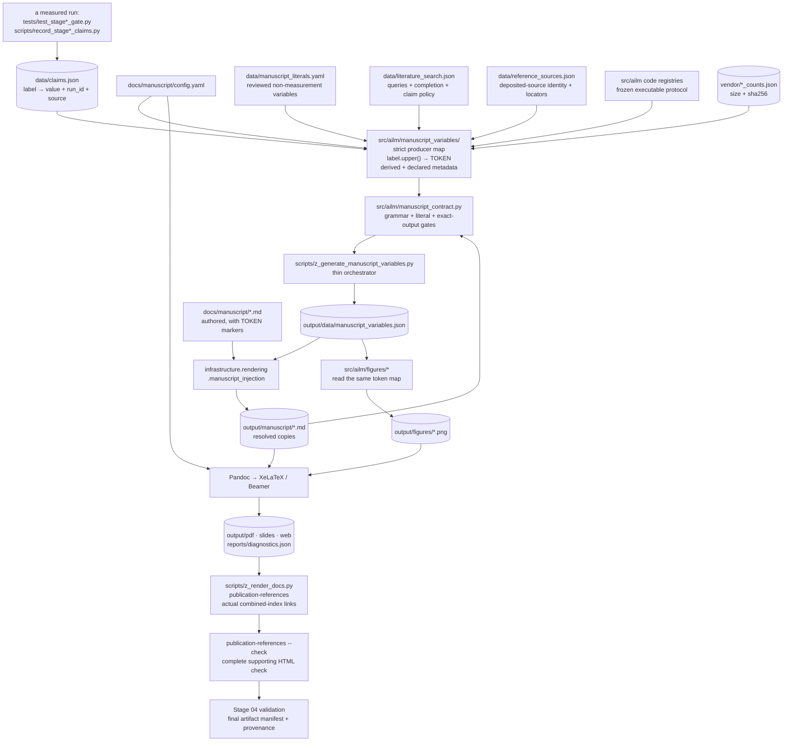

# Rendering Pipeline: Ledger → Tokens → PDF

How a measured number reaches the page, and why a number that was never measured
stops the build instead of appearing as plausible-looking text.

The design goal is narrow and worth stating plainly: **a hand-typed number in the
manuscript should be impossible, not discouraged.** Every quantitative statement in
`docs/manuscript/*.md` uses the registered token contract. Measured values
resolve from the ledger; declared non-measurement metadata and executable
protocol values have separate checked producers. Unknown or missing tokens fail
the render.

## The flow



Note that the figures hang off the *same* token map as the prose. That is
deliberate: a perplexity typed into plotting code is exactly as fabricated as one
typed into prose and considerably harder to notice, so the figure modules load
`output/data/manuscript_variables.json` and raise if a token they need is absent.
The consequence is an ordering constraint — record claims, then hydrate tokens, then
generate figures, then render.

That constraint is now enforced rather than only stated.
`tests/test_release_orchestration.py` asserts the *index* of
`manuscript-variables` is below that of `figures` in the full profile. It
previously asserted only that both names were present, which a set can check and
order cannot survive: `scripts/verify_release.py` ran figures first, and because
`output/data/manuscript_variables.json` is a tracked file, a stale map never
raised `MissingVariableError`. It supplied the previous ledger and the figures
drew it. One figure shipped that way (decision 69).

## Step 1 — the ledger

`data/claims.json` maps a label to a value plus its provenance (`run_id`, `source`).
It is written only by a measured run: the `scripts/record_stage*_claims.py`
recorders. Tests may write explicitly test-owned fixture labels but may not
replace a recorder’s scientific namespace; the single-writer controls enforce
that distinction. Every entry must carry both
provenance fields — `tests/test_claims_discipline.py::test_every_ledger_entry_has_provenance`
enforces that, because a recorded number without provenance cannot be re-derived.

```bash
.venv/bin/python scripts/record_stage0_claims.py
.venv/bin/python scripts/record_stage1_claims.py
.venv/bin/python scripts/record_stage2_claims.py
```

Downstream consumers may derive declared quantities from these values or read
validated metadata producers. They may not fabricate a missing measured value.

## Step 2 — the token map

`src/ailm/manuscript_variables/_core.py::generate_manuscript_variables(project_root)`
returns a flat `dict[str, str]`. Eight kinds of entry:

| Kind | Rule | Example |
|---|---|---|
| Ledger value | The label, uppercased. There is **no second mapping table** to drift out of sync with the ledger | ledger `stage1_letter_perplexity` → `{{STAGE1_LETTER_PERPLEXITY}}` |
| Ledger provenance | Two companions per label, so the manuscript can cite where a number came from without a second lookup | `{{STAGE1_LETTER_PERPLEXITY_RUN}}`, `{{STAGE1_LETTER_PERPLEXITY_SOURCE}}` |
| Derived quantity | Computed from two or more ledger entries, because the ledger stores the parts | `{{STAGE1_UNIGRAM_MARGIN}}`, `{{STAGE2_PHONEME_UNIGRAM_MARGIN}}`, `{{STAGE1_CEILING_SHORTFALL_RATIO}}`, `{{STAGE2_MCNEMAR_TOTAL_DISCORDANT}}` |
| Declared non-measurement variable | Read from the validated v2 registry in `data/manuscript_literals.yaml`; every entry carries a substantive reason and cannot shadow a claim | `{{DECISION_CONFIRMATORY_REPLICATION}}`, `{{DECISION_CZECH_CASE_PROTOCOL}}` |
| Literature-search variable | Read from the duplicate-refusing `data/literature_search.json` record, which binds the cutoff to a real search date and forbids priority wording while any declared source is incomplete | `{{LITERATURE_SEARCH_CUTOFF}}`, `{{LITERATURE_PRIORITY_CLAIM_ALLOWED}}` |
| Deposited-source variable | Read directly from the duplicate-refusing `data/reference_sources.json` snapshot; versions, dates, extents, and PDF locators have no second literal copy | `{{CEREBRUM_ZENODO_VERSION}}`, `{{CEREBRUM_POMDP_SUPPLEMENT}}`, `{{COMPOSITIONAL_CASE_PDF_PAGE_COUNT}}` |
| Code-owned protocol variable | Read from the executable registry used by the recorder/scorer; recorded protocol claims are checked back against that registry | `{{HISTORICAL_STAGE2_GATE_PCT}}`, `{{BENCH_G2P_BUCKET_MID_RANGE}}`, `{{DIGEST_SHORT_LENGTH}}` |
| Build metadata | Prefixed `META_`. Paper metadata from `docs/manuscript/config.yaml`, plus the size and sha256 of each vendored corpus artifact so a reader can verify they have the same bytes | `{{META_TITLE}}`, `{{META_AUTHORS}}`, `{{META_CLAIM_COUNT}}`, `{{META_BUILD_TIMESTAMP}}`, `{{META_BROWN_COUNTS_SHA256_SHORT}}` |

The label-uppercased rule is the load-bearing simplification. A token name is
mechanically derivable from a ledger label, so there is no mapping file that can
quietly disagree with the ledger.

`{{META_BUILD_TIMESTAMP}}` honours `SOURCE_DATE_EPOCH` when set. When it is
absent, direct manuscript generation and the release runner both derive the
epoch of the last audited commit that touched an input outside `output/`, so a
plain regeneration and the release runner produce the same reproducible stamp,
and a commit that only refreshes `output/` leaves the stamp where it is.

### `REQUIRED_CLAIMS` and why the derived block is listed there too

`REQUIRED_CLAIMS` is the set of labels that must exist before a render is allowed.
A missing one means the manuscript would describe a measurement that was never
taken, so `_load_claims` raises `MissingClaimError` listing every absent label at
once.

The guard lists **everything this module reads**, not only what prose references
directly. The derived-quantity block reads `stage2_g2p_mcnemar_b` and
`stage2_g2p_mcnemar_c` even though prose may cite them only through the derived
total; without them in `REQUIRED_CLAIMS`, a ledger could satisfy the guard and then
still fail deep inside the function with a bare `KeyError`. That is precisely what
`tests/test_manuscript_variables.py` caught, and why the internal `num()` helper
raises a diagnosable `MissingClaimError` naming the label *and* pointing at
`REQUIRED_CLAIMS` rather than letting a `KeyError` escape.

## Step 3 — the orchestrator

```bash
# Write the token map only. [verified]
.venv/bin/python scripts/z_generate_manuscript_variables.py --print-only

# Write the token map AND inject the manuscript tree.
TEMPLATE_REPO_ROOT="$AILM_TEMPLATE_ROOT" \
  .venv/bin/python scripts/z_generate_manuscript_variables.py
```

`scripts/z_generate_manuscript_variables.py` computes nothing. It calls
`generate_manuscript_variables`, then the project contract rejects malformed,
unknown, empty, recursive, or hard-coded result/configuration variables before
anything is injected. It publishes `output/data/manuscript_variables.json` with
an fsynced temporary file and atomic rename, then hands the map to
`infrastructure.rendering.manuscript_injection.write_resolved_manuscript_tree`.
Afterward the contract independently substitutes every source and requires byte
identity, an exact source/output file inventory, and zero surviving brace markers.

Exit codes: `0` on success; `1` on an unresolvable template root, invalid
ledger/config/literal input, source-contract failure, or injection/output-contract
failure. The shared writer's unresolved-token warning is therefore not accepted
as AILM success.

`--print-only` still validates the authored source and hard-coded-variable gate,
then stops after the token map. It is the right command when you want to inspect
tokens, or when you are working in the sidecar without a template checkout to hand.

## The `TEMPLATE_REPO_ROOT` requirement

This is the one piece of the flow that exists purely because AILM is a symlinked
sidecar, and it is worth understanding before debugging a render failure.

The canonical exemplars live *inside* the template repository, so they can find the
`infrastructure` package with a relative walk-up — `Path(__file__).parents[3]` and
similar. **AILM cannot.** It is a standalone checkout that is *symlinked* into
`template/projects/working/`. A relative walk-up from the real path lands in the
sidecar's parent directory, which contains no `infrastructure` package — or,
worse, could one day contain an unrelated one and be imported silently.

So the script resolves the template root explicitly, in this order (the docstring
of `_resolve_template_root` in `scripts/z_generate_manuscript_variables.py` is the
authoritative list):

1. **`TEMPLATE_REPO_ROOT`** — the authoritative answer. The renderer sets it
   (`infrastructure/rendering/_manuscript_source.py` puts the repo root into the
   subprocess environment before invoking the script).
2. **`.template-root`** at the repository root — the per-machine declaration,
   read by `ailm.template_root` and restated in the release verifier. One path;
   gitignored; equally final, so a declared path that holds no template is an
   error rather than a reason to search on. Write it once and every
   provider-dependent command on that machine finds the checkout without the
   environment variable.
3. A walk-up from the script's own location, for the case where the project genuinely
   does live inside the template repo.
4. The `template` checkout beside the `projects` sidecar root, which is the canonical
   `<root>/template` plus `<root>/projects/working/<name>` layout.
5. The conventional home-directory checkout, for manual invocation elsewhere.

Each candidate is accepted only if `<candidate>/infrastructure/__init__.py` is a
file, so a directory that merely has the right name is rejected.

If none resolves, the script **refuses to continue** and exits `1`. It does not fall
back to writing an un-injected manuscript, because a manuscript full of unresolved
`{{TOKEN}}` markers reads as fabricated results. The error message says so.

Two related facts about how the renderer invokes it:

- It runs the script with **the project's own `.venv`** (`resolve_test_python`), not
  the template's interpreter. The sidecar's pinned pymdp and numpy are what compute
  the tokens.
- The subprocess has a timeout. If token generation becomes slow enough to trip it,
  the render fails rather than proceeding with a stale map.

## A missing claim fails the render — by design

The abort is early and total, not a warning:

```text
data/claims.json lacks a REQUIRED_CLAIMS label
        ↓
generate_manuscript_variables raises MissingClaimError
        ↓
z_generate_manuscript_variables.py prints the label list to stderr, exits 1
        ↓
run_manuscript_variable_script returns 1
        ↓
infrastructure/rendering/pipeline.py:  if hydrate_manuscript(...) != 0: return 1
        ↓
no LaTeX validation, no Pandoc, no PDF
```

Nothing is rendered from a partially-known ledger. The failure names the missing
labels and tells you to record them from the run that produced the value rather
than hand-writing the number into prose.

The corollary matters just as much: **do not reach for
`--skip-manuscript-hydration` to get past a hydration failure.** That flag exists
for fast title-page and metadata re-renders when the token map is already correct.
Using it to route around a `MissingClaimError` renders whatever `output/manuscript/`
happens to hold, which may be a stale map from an earlier ledger — a silently wrong
PDF instead of a loud failure.

There is one sanctioned use, and the distinction is the whole point. Stage 03
re-runs hydration defensively under a fixed subprocess timeout, and on a loaded
machine that timeout can expire while hydration is still working correctly: the
symptom is `Manuscript variable hydration failed to execute: ... timed out`, with
no missing label named. If you have just run `scripts/z_generate_manuscript_variables.py`
yourself and it exited zero, the token map on disk is the current one and the flag
renders exactly what you generated. The failing case and the sanctioned case are
told apart by what the error says, never by how inconvenient the failure is: a
named missing claim means stop and record it; a timeout after a clean local
hydration means re-run the stage with the flag, or wait for the machine to quiet
down and run it without.

## Step 4 — render

Prepare the supporting companions from the AILM root. Rendering and final
validation run in the template checkout; the intervening HTML repair runs here:

```bash
AILM_PROJECT_ROOT="$(pwd -P)"
export TEMPLATE_REPO_ROOT="$AILM_TEMPLATE_ROOT"
.venv/bin/python scripts/z_render_docs.py --supporting-protocols
.venv/bin/python scripts/z_render_docs.py --check
cd "$AILM_TEMPLATE_ROOT"   # the selected docxology/template checkout
uv run --locked python scripts/pipeline/stage_03_render.py \
  --project working/active_inference_language_model

cd "$AILM_PROJECT_ROOT"
.venv/bin/python scripts/z_render_docs.py --publication-references
.venv/bin/python scripts/z_render_docs.py --publication-references --check
.venv/bin/python scripts/z_render_docs.py --check --supporting-protocols
cd "$AILM_TEMPLATE_ROOT"
uv run --locked python scripts/pipeline/stage_04_validate.py \
  --project working/active_inference_language_model
```

The qualified `working/active_inference_language_model` route names the intended
symlink explicitly. A bare name may prefer a matching `projects/active/` entry;
it is equivalent only when that resolution actually points to this checkout.
The full release runner verifies the selected route before and after execution.
The pre-render documentation check covers the hydrated mirror. Complete HTML
acceptance follows the reference repair, which derives individual-page targets
and display numbers from the actual combined index. It preserves literal code
examples and refuses missing, malformed or inconsistent references. Final Stage
04 validation therefore binds its manifest and provenance to the repaired tree.

What happens, in order:

1. Manuscript-variable hydration (above). Failure aborts here.
2. `resolve_manuscript_dir` — if `output/manuscript/` exists and holds `*.md`, that
   injected tree is what gets rendered, with `config.yaml`, `preamble.md` and any
   `*.bib` refreshed into it from `docs/manuscript/`. **This is why editing
   `output/manuscript/*.md` is never the fix:** those files are overwritten on the
   next hydration, and meanwhile they are what the renderer actually reads, so an
   edit there produces a PDF that no source file explains.
3. A `scripts/_render_pdf_override.py`, if present, takes over completely. AILM does
   not ship one.
4. LaTeX package validation. Missing required packages abort.
5. Figure verification against `output/figures/`.
6. Per-section rendering to HTML and Beamer, then the combined PDF.

Outputs land under the sidecar's `output/` — see
[`output_inventory.md`](../reference/output_inventory.md) for the full artifact list.

### Read `output/reports/diagnostics.json` before theorizing

The renderer writes a structured, per-file failure record. A section whose slides
fail LaTeX is named there with its log tail and its recent errors, which is
considerably faster than opening every section's `.log` in turn. Reproduce before
fixing: open the diagnostic, then the named `.log`, then the source section.

Stage 03 producing files is not publication acceptance by itself. The full release
orchestrator next repairs and checks individual HTML references and complete
supporting HTML, then requires `qpdf --check`, the repository's structural
PDF-integrity tests, and template Stage 04 validation. It fingerprints both Git repositories,
blocks render descendants when an upstream gate fails, and records blocked steps
explicitly when `--keep-going` is used. An explicit `TEMPLATE_REPO_ROOT` is final;
if it is invalid or dirty, the full profile refuses the run instead of silently
selecting another checkout. Because the template ignores its project routes, the
orchestrator validates the selected route again at finish in addition to comparing
the template Git fingerprint.

`success` and `publication_acceptance` are intentionally separate receipt fields.
The development-only dirty override may complete all checks, but it can never
produce publication acceptance. The full runner also replaces an inherited
`SOURCE_DATE_EPOCH` with the audited source epoch recorded in the receipt. It sets
`FORCE_SOURCE_DATE=1` as release policy, so XeLaTeX initializes its calendar
primitives from that same epoch: the visible cover date produced by `\today`
follows the source date as well as the PDF metadata. The receipt records the
forced flag and its policy origin; an inherited caller flag cannot disable it.

The hosted workflow runs `quick` only, through the sidecar's explicit
`.venv/bin/python -I -S`. Full acceptance is deliberately workstation-bound because it
consumes an ignored external-call cache, rechecks a stratified sample against a
reachable Ollama server serving every declared probe, and uses a
clean, exactly routed template checkout before invoking the local
Lean/TeX/Pandoc/`qpdf` stack.
Fresh hosted acquisition happens before this acceptance phase with its own
credential and approved budget. Use the [clean release invocation](release_checklist.md#the-sequence)
with those acquisition variables unset; the verifier does not automatically drop
an inherited API key. Before the local live recheck,
`scripts/verify_network_claim_bindings.py` proves that
every recorder excluded from hermetic end-to-end replay has a complete receipt
for its current ledger namespace. The receipt binds source and vendored inputs,
the recorder's canonical configuration, model identities, and exact trusted
call records. Each recorder must also expose a semantic validator that rederives
its complete bound claim namespace; a digest-valid but scientifically impossible
claim projection therefore fails. A source or configuration edit makes the old
receipt fail rather than silently describing the new code.
CI without those inputs is not permitted to label a skipped or predictably failing
job as a full publication check.

## Review the PDF as a deliverable

After structural validation, open the actual combined PDF and inspect it at the
intended page size. Check title and availability statements, equation/citation
resolution, table continuation, figure captions and alt-text correspondence,
font legibility, clipping and excessive blank pages. Preserve the PDF digest,
compiler/validator logs and reviewed page captures together. This review does
not measure new results or replace semantic receipt validation; it verifies the
artifact Daniel is being asked to approve. Follow the
[release checklist](release_checklist.md) for the final source/evidence freeze.

## Mermaid diagrams and the combined PDF

Any ` ```mermaid ` block that reaches the **combined** PDF is rasterised by `mmdc`
(mermaid-cli), which drives a pinned `chrome-headless-shell` through Puppeteer.
Per-section slide PDFs do not invoke `mmdc`, so "the slides render but the combined
PDF fails" with a `Could not find Chrome` message is the signature of that missing
browser rather than of anything in the manuscript. Install it once per machine:

```bash
# Run in the prepared template checkout using its pinned browser tooling.
./node_modules/.bin/puppeteer browsers install chrome-headless-shell
```

Diagrams in `docs/` are never rendered through Pandoc, so this constraint applies to
`docs/manuscript/` only.

## `config.yaml` controls

| Key | Controls | Consumed by |
|---|---|---|
| `paper.title` | PDF title page, page headers, `{{META_TITLE}}` | renderer; `manuscript_variables.py` |
| `paper.version` | `{{META_VERSION}}` | `manuscript_variables.py` |
| `authors[*]` | Title-page author block, `{{META_AUTHORS}}`, `{{META_AUTHOR_COUNT}}` | renderer; `manuscript_variables.py` |
| `publication.doi` | Optional verified DOI on the title page and in citations; currently absent while public archival availability is unverified | renderer |
| `publication.doi_status` | Plain title-page status text for the authenticated reserved, unpublished draft DOI; used when `publication.doi` is absent and does not create a DOI hyperlink | renderer |
| `keywords` | `{{META_KEYWORDS}}` | `manuscript_variables.py` |
| `llm.translations.enabled` | Whether the pipeline's LLM translation stage runs. Currently `false` | `execute_pipeline.py` |

## Troubleshooting

| Symptom | Cause | Fix |
|---|---|---|
| `MissingClaimError` naming labels | The ledger lacks a `REQUIRED_CLAIMS` entry | Run the relevant `scripts/record_stage*_claims.py`. Do not delete the token, and do not skip hydration |
| `could not locate the template repo root` | Running by hand from the sidecar with no template checkout at the conventional path | `export TEMPLATE_REPO_ROOT="$AILM_TEMPLATE_ROOT"`, or use `--print-only` if you only need the token map |
| A literal `{{TOKEN}}` in a rendered artifact | The manuscript references a token the map does not define, or the render used a stale `output/manuscript/` | Re-run hydration; then `rg -n -F '{{' output/manuscript/` |
| A figure disagrees with the prose beside it | Figures were generated from an older token map | Re-run hydration, then `scripts/generate_figures.py`. The figure modules also re-derive ledger identities and raise rather than draw a story the ledger no longer supports |
| A selective figure build or registry read reports stale code/input/output provenance | The v3 receipt no longer authenticates the exact AILM source inventory, bounded data/vendor/GNN inputs, or published PNG set | Run a full `MPLBACKEND=Agg .venv/bin/python scripts/generate_figures.py`, then regenerate the figure registry. The receipt is published last as a fail-detect commit marker; it does not claim a multi-PNG batch replacement is atomic |
| Combined PDF missing, slides present, `Could not find Chrome` | `chrome-headless-shell` absent | Use the prepared template checkout’s pinned browser installer described above |
| Combined PDF missing, per-file render errors reported | A manuscript section's LaTeX failed | `output/reports/diagnostics.json`, then the named `output/slides/*.log` |
| Undefined citation or BibTeX error | Malformed `docs/manuscript/references.bib` | Check `output/pdf/_combined_manuscript.log` for the specific key |

## Cross-references

- [`syntax_guide.md`](../syntax_guide.md) — the `{{TOKEN}}` and `claim:<label>` protocols and the cross-reference conventions
- [`output_conventions.md`](../reference/output_conventions.md) — the regenerable boundary and the regeneration order
- [`output_inventory.md`](../reference/output_inventory.md) — every artifact this pipeline writes
- [`architecture.md`](../architecture.md) — why `src/` may not import `infrastructure`
- [`provenance/sources.md`](../provenance/sources.md) — the vendored artifacts whose checksums become `META_*` tokens
- [`../src/ailm/manuscript_variables/`](../../src/ailm/manuscript_variables/__init__.py) — strict token producers and derived values
- [`../src/ailm/manuscript_contract.py`](../../src/ailm/manuscript_contract.py) — pre-injection grammar/literal checks and exact post-injection validation
- [`../scripts/z_generate_manuscript_variables.py`](../../scripts/z_generate_manuscript_variables.py) — the template-root resolution
