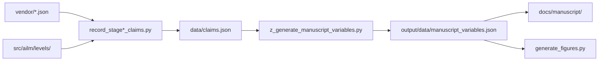

# scripts/ — thin orchestrators and evidence writers

Every script in this directory is a **thin orchestrator**: argument parsing,
path bootstrap, logging, and delegated calls into `src/ailm/` entrypoints.
Business, data, plot, and analysis logic lives in `src/ailm/`, where the
coverage gate and unit suites exercise it. Bounded recorder-specific estimands
may remain beside their sole recorders when they are pure and directly
exercised by recorder replay and focused tests; any shared computation moves
into `src/ailm/` instead of being copied. Scripts uniquely own **the artifacts
in `vendor/`** and **the numbers in `data/claims.json`**.

## Inventory

Complete as of the 2026-09-15 scripts audit — 93 Python files. Each tabulated row
names the script's own measurement modules. The `evaluate_*` family prints a
structural report and records nothing; `generate_*` writes only `vendor/`
artifacts and rendered outputs; only `record_*` writes `data/claims.json`. Two
plumbing imports are omitted per row:
`ailm.ledger_lock` (used by every `record_*` recorder alongside `ailm.claims`)
and the `_artifact_io.py` atomic writer (used by most generators). Run every
command with `.venv/bin/python` — never `uv run` in this sidecar (see
[`AGENTS.md`](AGENTS.md)).

| Script | Purpose | Delegates to | Run command |
| --- | --- | --- | --- |
| `_artifact_io.py` | Atomic serialization shared by deterministic artifact generators; helper, not run directly | imported by the writers below | — |
| `assign_claim_status.py` | Assign an epistemic status to every ledger claim that lacks one | `ailm.claims` | `.venv/bin/python scripts/assign_claim_status.py` |
| `audit_gates.py` | Audit every stage gate for vacuity and reachability; exits non-zero on a non-bracketed verdict | `ailm.gates`, `ailm.levels.*`, `ailm.verification.oracle` | `.venv/bin/python scripts/audit_gates.py` (`--json` also writes `output/reports/gate_audit.json`) |
| `build_web_ailm.py` | Assemble the generated standalone AILM local demo; records nothing | self-contained assembler | `.venv/bin/python scripts/build_web_ailm.py` |
| `evaluate_case_word_channel.py` | Structural evaluation of the L4→L3 case-word bridge (model-sender arm): anchor identity, seam normalization, causal reachability; prints a report and records nothing | `ailm.case_word_channel`, `ailm.corpus.case_word`, `ailm.levels.case` | `.venv/bin/python scripts/evaluate_case_word_channel.py` |
| `evaluate_synthetic_aligned_g2p.py` | Offline evaluation of the stipulated aligned spelling-to-pronunciation arm on identical held-out positions, with its English-transfer, broken-correspondence, and uniform-floor controls; prints a report and records nothing | `ailm.benchmarks.aligned_g2p`, `ailm.levels.phoneme` | `.venv/bin/python scripts/evaluate_synthetic_aligned_g2p.py` |
| `export_web_model.py` | Export the shipped AILM matrices for the browser build; records nothing | `ailm.generation`, `ailm.levels.letter`, `ailm.levels.word` | `.venv/bin/python scripts/export_web_model.py` |
| `fillmore_subject_rerun.py` | Decision 42's registered per-token re-run of the Fillmore subject arm | standalone | `.venv/bin/python scripts/fillmore_subject_rerun.py` |
| `generate_case_counts.py` | Generate the vendored Stage 4 case artifact from UD English EWT | `ailm.cases`, `ailm.corpus.ud` | `.venv/bin/python scripts/generate_case_counts.py` |
| `generate_case_counts_test.py` | Generate the Stage 4 case artifact from the UD English EWT *test* split (decision-79 prep; retired-pending) | `ailm.cases`, `ailm.corpus.ud` | `.venv/bin/python scripts/generate_case_counts_test.py` |
| `generate_case_word_counts.py` | Generate the case-word (L4→L3) bridge artifact from UD EWT dev: one `(word_form, upos, case_label_or_null, label_source)` row per token, train-only sender map, per-route coverage and agreement | `ailm.corpus.case_word`, `ailm.corpus.ud`, `ailm.levels.word` | `.venv/bin/python scripts/generate_case_word_counts.py` |
| `generate_clause_counts.py` | Generate the vendored Stage 5 clause artifact from UD English EWT | `ailm.corpus.ud` | `.venv/bin/python scripts/generate_clause_counts.py` |
| `generate_clause_widened_counts.py` | Generate the vendored widened Stage 5 artifact from UD English EWT | `ailm.corpus.ud`, `ailm.levels.widened` | `.venv/bin/python scripts/generate_clause_widened_counts.py` |
| `generate_clause_word_counts.py` | Generate the vendored punctuation-type-oracle → word-prior artifact | `ailm.corpus.brown`, `ailm.levels.clause_channel`, `ailm.levels.word` | `.venv/bin/python scripts/generate_clause_word_counts.py` |
| `generate_confirmatory_ewt_counts.py` | Vendor the decision-111 confirmatory evaluation population from UD English EWT test | `ailm.cases`, `ailm.corpus.ud` | `.venv/bin/python scripts/generate_confirmatory_ewt_counts.py` |
| `generate_counts.py` | Generate character-bigram counts over the AILM 30-symbol alphabet (letters) | `ailm.corpus.brown` | `.venv/bin/python scripts/generate_counts.py` |
| `generate_cover.py` | Generate the AILM cover from model structure and gate verdicts; `--check` rejects missing or stale bytes without writing | `ailm.figures.architecture`, `ailm.viz_config`, `_artifact_io` | `.venv/bin/python scripts/generate_cover.py [--check]` |
| `generate_czech_case_counts.py` | Generate the vendored Czech case artifact from UD Czech-PDTC (decision 77) | `ailm.corpus.ud_czech`, `ailm.levels.case_czech` | `.venv/bin/python scripts/generate_czech_case_counts.py` |
| `generate_extlex_stage_stats.py` | Stage and characterize the external WikiPron lexicon candidate (extlex lane) | `ailm.corpus.cmudict` | `.venv/bin/python scripts/generate_extlex_stage_stats.py` |
| `generate_figure_registry.py` | Publish `output/figures/figure_registry.json` via the template's own builder; `--check` verifies without writing | `infrastructure.documentation` (template root resolved first; sanctioned boundary — see `docs/architecture.md`) | `.venv/bin/python scripts/generate_figure_registry.py` |
| `generate_figures.py` | Generate every AILM manuscript figure and the v3 provenance receipt | `ailm.figures.*` (discovered `generate_*` modules) | `MPLBACKEND=Agg .venv/bin/python scripts/generate_figures.py` |
| `generate_fitted_probe_data.py` | Generate the fitted-probe fitting datasets (letter, phoneme, G2P) and their verifiable receipt; deterministic data preparation only | `ailm.benchmarks.fitted`, `ailm.benchmarks.constants`, `ailm.corpus.brown` (the letter dataset consumes the nltk-brown letter path through `fitted.data.letter_stream_from_raw`) | `.venv/bin/python scripts/generate_fitted_probe_data.py` |
| `generate_heldout_stream.py` | Vendor the complete held-out alphabetic Brown stream | `ailm.corpus.brown` | `.venv/bin/python scripts/generate_heldout_stream.py` |
| `generate_lean_ledger.py` | Generate `formal/AILM/LedgerData.lean` from `data/claims.json` — that file's only writer, under a byte-identity test | reads `data/claims.json`, writes Lean | `.venv/bin/python scripts/generate_lean_ledger.py` |
| `generate_narrative_counts.py` | Generate the vendored Stage 6 narrative artifact from UD English EWT | `ailm.corpus.ud` | `.venv/bin/python scripts/generate_narrative_counts.py` |
| `generate_online_genre_counts.py` | Generate the vendored entry-28 online-learning drift artifact from Brown | `ailm.corpus.brown`, `ailm.levels.letter` | `.venv/bin/python scripts/generate_online_genre_counts.py` |
| `generate_phoneme_counts.py` | Generate `vendor/cmudict_counts.json` — the Stage 2 phoneme corpus artifact | `ailm.corpus.cmudict`, `ailm.levels.letter` | `.venv/bin/python scripts/generate_phoneme_counts.py` |
| `generate_pymdp_sparse_patch.py` | Generate the candidate upstream pymdp patch from the installed source | reads installed `pymdp` source | `.venv/bin/python scripts/generate_pymdp_sparse_patch.py` |
| `generate_synthetic_aligned_g2p.py` | Generate the stipulated aligned spelling-to-pronunciation artifact: a seeded per-letter correspondence onto the canonical 39-phone inventory, with train/test word splits | `ailm.benchmarks.aligned_g2p` | `.venv/bin/python scripts/generate_synthetic_aligned_g2p.py` |
| `generate_synthetic_counts.py` | Generate the stipulated synthetic letter-bigram artifact | `ailm.levels.synthetic` | `.venv/bin/python scripts/generate_synthetic_counts.py` |
| `generate_synthetic_phone_counts.py` | Generate the stipulated synthetic phone-bigram artifact | `ailm.levels.synthetic` | `.venv/bin/python scripts/generate_synthetic_phone_counts.py` |
| `generate_word_counts.py` | Generate the vendored Stage 3 word artifact from the NLTK Brown corpus | `ailm.corpus.brown` | `.venv/bin/python scripts/generate_word_counts.py` |
| `list_raw_corpus_inputs.py` | Describe the exact ignored raw-corpus files consumed by release replay | `ailm.corpus.*` | `.venv/bin/python scripts/list_raw_corpus_inputs.py` |
| `orchestrate_claim_recorders.py` | Run the complete dynamically discovered claims-recorder inventory by phase | `ailm.replay_provenance` | `.venv/bin/python scripts/orchestrate_claim_recorders.py core\|network\|formal\|aggregate` |
| `precheck_confirmatory_replication.py` | Decision-79 confirmatory replication precheck — prep only, no scoring (retired-pending) | `ailm.statistics` | `.venv/bin/python scripts/precheck_confirmatory_replication.py` |
| `probe_budgeted_attention.py` | Kill-check for budgeted attention: is adaptive selection worth its inference? | `ailm.levels.letter`, `ailm.levels.phoneme` | `.venv/bin/python scripts/probe_budgeted_attention.py` |
| `probe_channel_predictive_loss.py` | Probe proper predictive loss across the L1→L2B channel, and the value inequality | `ailm.channels`, `ailm.levels.coupling`, `ailm.levels.lexical_channel` | `.venv/bin/python scripts/probe_channel_predictive_loss.py` |
| `probe_l4_case_marking_treebank.py` | Probe Level 4 on morphologically case-marking Universal Dependencies properties | `ailm.cases`, `ailm.corpus.ud`, `ailm.statistics` | `.venv/bin/python scripts/probe_l4_case_marking_treebank.py` |
| `probe_l5_widened_alphabet.py` | Probe Level 5 alphabet widening with distinguished VERB and AUX symbols | `ailm.corpus.ud`, `ailm.levels.widened` | `.venv/bin/python scripts/probe_l5_widened_alphabet.py` |
| `probe_pymdp_sparse.py` | Probe pymdp sparse capabilities, blocking sites, and exact equivalence | `ailm.levels.word` | `.venv/bin/python scripts/probe_pymdp_sparse.py` |
| `record_aligned_g2p_comparator_claims.py` | Record the P2 stipulated-alignment comparator arm's offline claims, behind its A1/A2/A3 refusal gates | `ailm.benchmarks.aligned_g2p`, `ailm.levels.phoneme`, `ailm.claims` | `.venv/bin/python scripts/record_aligned_g2p_comparator_claims.py` |
| `record_aligned_g2p_probe_claims.py` | Record the P2 zero-shot probe arms for the three registered served probes through the shipped Ollama transport; a publication run writes the network claim binding receipt | `ailm.benchmarks.aligned_g2p`, `ailm.benchmarks`, `ailm.call_cache`, `ailm.replay_provenance` | `.venv/bin/python scripts/record_aligned_g2p_probe_claims.py` |
| `record_budgeted_attention_claims.py` | Record the budgeted-attention comparison. Single writer for `budget_*` | `ailm.claims` | `.venv/bin/python scripts/record_budgeted_attention_claims.py` |
| `record_calibration_floor_claims.py` | Locate the external benchmark's captured-mass floor empirically, offline | `ailm.benchmarks`, `ailm.levels.letter` | `.venv/bin/python scripts/record_calibration_floor_claims.py` |
| `record_case_word_influence_claims.py` | Record the decision-121 case-word influence sweep over the L3 word-prior inlet | `ailm.case_word_channel`, `ailm.levels.clause_channel`, `ailm.corpus.case_word`, `ailm.claims` | `.venv/bin/python scripts/record_case_word_influence_claims.py` |
| `record_channel_factorial_claims.py` | Measure all four cells of the channel factorial and record them atomically | `ailm.channels`, `ailm.levels.coupling`, `ailm.levels.lexical_channel` | `.venv/bin/python scripts/record_channel_factorial_claims.py` |
| `record_channel_predictive_loss_claims.py` | Record the L1→L2B channel on the receiver's own proper predictive loss | `ailm.claims` | `.venv/bin/python scripts/record_channel_predictive_loss_claims.py` |
| `record_clause_channel_claims.py` | Record the punctuation-type-oracle → L3 measurement (decision entry 27) | `ailm.levels.clause_channel`, `ailm.levels.word`, `ailm.verification.oracle` | `.venv/bin/python scripts/record_clause_channel_claims.py` |
| `record_cluster_claims.py` | Re-run every paired comparison at its natural independent sampling unit | `ailm.clustering`, `ailm.levels.*`, `ailm.statistics` | `.venv/bin/python scripts/record_cluster_claims.py` |
| `record_comparator_strength_claims.py` | Record how strong the comparator class actually is at Stage 2B and Level 4 | `ailm.comparators`, `ailm.levels.case`, `ailm.levels.phoneme` | `.venv/bin/python scripts/record_comparator_strength_claims.py` |
| `record_complexity_claims.py` | Record every computational-complexity number, from the run that counts it | `ailm.complexity`, `ailm.spec_agent`, `ailm.gnn` | `.venv/bin/python scripts/record_complexity_claims.py` |
| `record_confirmatory_replication.py` | Score the four `ud_ewt_test` family members once, under decision 111 | `ailm.levels.case/clause/narrative`, `ailm.statistics`, `ailm.control` | `.venv/bin/python scripts/record_confirmatory_replication.py` |
| `record_confirmatory_stage6_clustered_claims.py` | Record the document-clustered interval of the Level 6 improvement on the held-back split (decision 115) | `ailm.levels.narrative`, `ailm.clustering`, `ailm.statistics` | `.venv/bin/python scripts/record_confirmatory_stage6_clustered_claims.py` |
| `record_coupling_claims.py` | Record the L1→L2 coupling measurement into `data/claims.json` | `ailm.levels.coupling`, `ailm.levels.letter`, `ailm.levels.phoneme` | `.venv/bin/python scripts/record_coupling_claims.py` |
| `record_czech_case_claims.py` | Record the Czech case arm into the claims ledger (decision 77, exploratory) | `ailm.levels.case_czech`, `ailm.statistics` | `.venv/bin/python scripts/record_czech_case_claims.py` |
| `record_ewt_document_correction_claims.py` | Record the reproducible before/after English EWT boundary correction | `ailm.corpus.ud`, `ailm.levels.case/clause`, `ailm.clustering` | `.venv/bin/python scripts/record_ewt_document_correction_claims.py` |
| `record_external_benchmark_claims.py` | Measure and record the external Ollama benchmark; refuses partial runs | `ailm.benchmarks`, `ailm.call_cache`, `ailm.replay_provenance` | `.venv/bin/python scripts/record_external_benchmark_claims.py` |
| `record_fillmore_subject_claims.py` | Record the decision-42 Fillmore subject re-run into the claims ledger | `ailm.levels.case`, `ailm.corpus.ud` | `.venv/bin/python scripts/record_fillmore_subject_claims.py` |
| `record_fitted_channel_claims.py` | Fit the lexical channel's hyperparameters instead of choosing them | `ailm.channels`, `ailm.levels.lexical_channel` | `.venv/bin/python scripts/record_fitted_channel_claims.py` |
| `record_formal_claims.py` | Generate/check the axiom driver; record whole-tree and per-module counts only after a real build, fresh report, and complete coverage | `ailm.formal_inventory`, `ailm.claims` | `.venv/bin/python scripts/record_formal_claims.py` |
| `record_g2p_famsplit_claims.py` | Record the family-disjoint G2P arm (decision 74) and its family-grouped arm (decision 102) | `ailm.levels.letter/phoneme`, `ailm.statistics` | `.venv/bin/python scripts/record_g2p_famsplit_claims.py` |
| `record_g2p_learning_claims.py` | Record the pre-registered latent-state G2P `learn_A` experiment (decision 29) | `ailm.levels.g2p_learning`, `ailm.levels.phoneme` | `.venv/bin/python scripts/record_g2p_learning_claims.py` |
| `record_generation_claims.py` | Record every generation number into the claims ledger, from the run that measures it | `ailm.generation`, `ailm.levels.letter/word` | `.venv/bin/python scripts/record_generation_claims.py` |
| `record_generation_word_state_claims.py` | Record the third EFE degeneracy: word-state information gain that selects nothing | `ailm.generation`, `ailm.levels.letter/word` | `.venv/bin/python scripts/record_generation_word_state_claims.py` |
| `record_geometric_pooling_claims.py` | Measure geometric (log-linear) pooling against the shipped linear mixing rule | `ailm.channels`, `ailm.levels.coupling`, `ailm.levels.lexical_channel` | `.venv/bin/python scripts/record_geometric_pooling_claims.py` |
| `record_heldout_stream_claims.py` | Measure and record the first Stage 3 statement not conditioned on coverage | `ailm.levels.word` | `.venv/bin/python scripts/record_heldout_stream_claims.py` |
| `record_incontext_benchmark_claims.py` | Measure and record the in-context training-data arm of the synthetic probe | `ailm.benchmarks.synthetic_protocol`, `ailm.levels.synthetic`, `ailm.call_cache`, `ailm.replay_provenance` | `.venv/bin/python scripts/record_incontext_benchmark_claims.py` |
| `record_l1_context_control_claims.py` | Record the Level 1 context-destruction control (decision 73) | `ailm.comparators`, `ailm.levels.letter` | `.venv/bin/python scripts/record_l1_context_control_claims.py` |
| `record_learning_claims.py` | Record the W2 learning-equals-counting result, from the run that measured it | `ailm.learning`, `ailm.levels.letter` | `.venv/bin/python scripts/record_learning_claims.py` |
| `record_lexical_channel_claims.py` | Record the L3→L2B lexical-channel experiment — the test of entry 18's criterion | `ailm.levels.lexical_channel`, `ailm.levels.letter/phoneme` | `.venv/bin/python scripts/record_lexical_channel_claims.py` |
| `record_logprob_drift_claims.py` | Measure how far a replayed answer-slot distribution sits from a fresh one | `ailm.benchmarks`, `ailm.call_cache`, `ailm.replay_provenance` | `.venv/bin/python scripts/record_logprob_drift_claims.py` |
| `record_online_learning_claims.py` | Record the entry-28 online-vs-frozen learning measurement (decision 28) | `ailm.levels.online_learning`, `ailm.corpus.brown` | `.venv/bin/python scripts/record_online_learning_claims.py` |
| `record_parameter_claims.py` | Record the parameter count of every level and of the whole model | `ailm.parameters` | `.venv/bin/python scripts/record_parameter_claims.py` |
| `record_pymdp_equivalence_claims.py` | Record the L4/L5/L6 live-pymdp inference-equivalence evidence | `ailm.levels.case/clause/narrative`, `ailm.verification.oracle` | `.venv/bin/python scripts/record_pymdp_equivalence_claims.py` |
| `record_stage0_claims.py` | Record Stage 0 quantitative claims into `data/claims.json` | `ailm.corpus.cmudict`, `ailm.levels.letter/word` | `.venv/bin/python scripts/record_stage0_claims.py` |
| `record_stage1_claims.py` | Record Stage 1 quantitative claims into `data/claims.json` | `ailm.levels.letter`, `ailm.gates` | `.venv/bin/python scripts/record_stage1_claims.py` |
| `record_stage2_claims.py` | Record Stage 2 quantitative claims into `data/claims.json`, including the decoder-equivalence proof | `ailm.levels.letter/phoneme`, `ailm.statistics`, `ailm.verification.oracle` | `.venv/bin/python scripts/record_stage2_claims.py` |
| `record_stage3_claims.py` | Record every Stage 3 number into the claims ledger, from the run that measures it | `ailm.levels.word`, `ailm.complexity`, `ailm.verification.oracle` | `.venv/bin/python scripts/record_stage3_claims.py` |
| `record_stage4_claims.py` | Record every Stage 4 number into the claims ledger, from the run that measures it | `ailm.levels.case`, `ailm.cases`, `ailm.statistics` | `.venv/bin/python scripts/record_stage4_claims.py` |
| `record_stage5_claims.py` | Record every Stage 5 clause-level number, uncertainty, and control | `ailm.levels.clause`, `ailm.statistics`, `ailm.gates` | `.venv/bin/python scripts/record_stage5_claims.py` |
| `record_stage5_widened_claims.py` | Record every widened-alphabet Stage 5 number, uncertainty, and control | `ailm.levels.widened`, `ailm.levels.clause`, `ailm.statistics` | `.venv/bin/python scripts/record_stage5_widened_claims.py` |
| `record_stage6_claims.py` | Record every Stage 6 narrative-level number, against decision 25's predictions | `ailm.levels.narrative`, `ailm.levels.clause`, `ailm.statistics` | `.venv/bin/python scripts/record_stage6_claims.py` |
| `record_statistical_claims.py` | Record the declared multiplicity family and exact uncertainty summaries | `ailm.statistics` | `.venv/bin/python scripts/record_statistical_claims.py` |
| `record_subsample_claims.py` | Record the eval-subsample comparison — the paper's third finding, finally backed | `ailm.levels.letter/phoneme`, `ailm.statistics` | `.venv/bin/python scripts/record_subsample_claims.py` |
| `record_synthetic_benchmark_claims.py` | Measure and record both stipulated-language exact-artifact-overlap probes | `ailm.benchmarks.synthetic_protocol`, `ailm.levels.synthetic`, `ailm.call_cache`, `ailm.replay_provenance` | `.venv/bin/python scripts/record_synthetic_benchmark_claims.py` |
| `record_worked_example_claims.py` | Record the numbers behind the manuscript's worked interpretability example | `ailm.levels.letter` | `.venv/bin/python scripts/record_worked_example_claims.py` |
| `sweep_smoothing.py` | Sweep the add-k pseudocount over Level 1 held-out perplexity; writes nothing | `ailm.levels.letter`, `ailm.evaluation` | `.venv/bin/python scripts/sweep_smoothing.py` |
| `verify_network_claim_bindings.py` | Default-deny provenance-receipt validation for every network-excluded claim recorder | `ailm.replay_provenance`, `ailm.call_cache` | `.venv/bin/python scripts/verify_network_claim_bindings.py` |
| `verify_publication_derivative.py` | Execute explicit reviewed historical-measurement publication verification and a separate original-source live local cache audit | `ailm.publication_derivative`, `_publication_execution` | `.venv/bin/python -I -S scripts/verify_release.py full --publication-derivative CONTRACT_PATH` |
| `_publication_execution.py` | Materialize authenticated original source and launch isolated semantic, artist and transport-control subprocesses; internal support for the derivative verifier | `ailm.publication_derivative`, stdlib subprocess | invoked by `verify_publication_derivative.py` |
| `_publication_bootstrap.py` | Audit stdlib-only startup, original import roots and the recorded endpoint transport policy | stdlib, derivative identities | internal support for `verify_publication_derivative.py` |
| `_publication_artists.py` | Capture original/current/mutated numerical artists in isolated processes | stdlib, derivative identities | internal support for `verify_publication_derivative.py` |
| `_publication_controls.py` | Run real transport and source-mutation refusal controls | stdlib, derivative identities | internal support for `verify_publication_derivative.py` |
| `_publication_snapshot.py` | Materialize complete pinned regular-file source/evidence snapshots and temporary controls | stdlib, derivative identities | internal support for `verify_publication_derivative.py` |
| `verify_reference_sources.py` | Opt-in live verification of exact Zenodo records and deposited PDFs | `ailm.reference_sources` | `.venv/bin/python scripts/verify_reference_sources.py` |
| `record_connected_gum_claims.py` | Execute the frozen local raw-text GUM comparison with paired document uncertainty; authenticate inputs before writing claims | `ailm.corpus.connected_gum`, `ailm.levels.connected_evaluation` | `.venv/bin/python scripts/record_connected_gum_claims.py` |
| `run_connected_ailm.py` | Execute raw or structured connected inference, channel controls and optional next-word generation; emit strict JSON | `ailm.levels.connected`, connected model and input contracts | `.venv/bin/python scripts/run_connected_ailm.py --text "The man." --generate` |
| `verify_release.py` | Run reproducible release profiles and emit an evidence receipt | orchestrates subprocess steps | `.venv/bin/python -I -S scripts/verify_release.py` |
| `warm_call_cache.py` | Warm the memoized external-model call store, then say what to run next; `--check` preflights only | `ailm.benchmarks.ollama`, `ailm.call_cache` | `.venv/bin/python scripts/warm_call_cache.py` |
| `z_generate_manuscript_variables.py` | Generate and inject AILM manuscript `{{TOKEN}}` values; the `z_` prefix means it runs last | `ailm.manuscript_variables`, `infrastructure.rendering.manuscript_injection` | `.venv/bin/python scripts/z_generate_manuscript_variables.py` |
| `z_render_docs.py` | Resolve documentation claims; publish portable protocol companions; `--publication-references` repairs individual HTML references after rendering from actual combined-index links; `--check` rejects stale output without writing; `--prune-retired --dry-run` inventories retention and `--prune-retired` applies it | `ailm.docs_hydration`, `ailm.supporting_package` | `.venv/bin/python scripts/z_render_docs.py` |

## Running order

The block below runs the Part A spine end to end. The later stages and the channel,
learning, benchmark, and complexity recorders slot into step 2 alongside their Part A
siblings. `orchestrate_claim_recorders.py` discovers that inventory dynamically and
topologically orders the declared producer→consumer edges, so a consumer never checks
an absent or stale producer merely because its filename sorts first. Corpus generators
still precede every recorder that reads their artifacts. `record_formal_claims.py` keeps
its own place at step 5 because it reads a `lake build` rather than the corpus.

Set `AILM_TEMPLATE_ROOT` to the selected template checkout whose qualified project
route resolves to this AILM root. Export that choice before provider-dependent
hydration, supporting HTML, or figure-registry commands.

```bash
cd "$(git rev-parse --show-toplevel)"   # the repository root
export TEMPLATE_REPO_ROOT="$AILM_TEMPLATE_ROOT"

# 1. Corpus artifacts (network on first NLTK run; then offline and deterministic)
.venv/bin/python scripts/generate_counts.py
.venv/bin/python scripts/generate_phoneme_counts.py

# 2. Every offline measurement → the ledger, from live discovery
.venv/bin/python scripts/orchestrate_claim_recorders.py core

# 3. Every network measurement and its exact-call binding (requires the
#    documented local call store and all registered probes; canonical synthetic
#    recorders require fresh scored calls even when the store already has rows)
.venv/bin/python scripts/orchestrate_claim_recorders.py network

# 4. Aggregate claims after every contributing measurement
.venv/bin/python scripts/orchestrate_claim_recorders.py aggregate

# 5. Ledger → Lean, then a real build → ledger. This order, not the reverse:
#    the generator reads the ledger, the recorder reads the build.
.venv/bin/python scripts/generate_lean_ledger.py
(cd formal && lake build && ./Scripts/axiom_report.sh)
.venv/bin/python -m pytest tests/test_formal_isomorphism.py::test_the_negative_control_does_not_compile -v --no-cov
.venv/bin/python scripts/orchestrate_claim_recorders.py formal
.venv/bin/python scripts/generate_lean_ledger.py --check   # the bridge still matches the ledger the build read

# 6. Complete the ledger contract, then audit every gate.
.venv/bin/python scripts/assign_claim_status.py
.venv/bin/python scripts/audit_gates.py

# 7. Ledger → manuscript tokens → figures
.venv/bin/python scripts/z_generate_manuscript_variables.py
MPLBACKEND=Agg .venv/bin/python scripts/generate_figures.py
MPLBACKEND=Agg .venv/bin/python scripts/generate_cover.py
MPLBACKEND=Agg .venv/bin/python scripts/generate_cover.py --check

# 8. Hydrate the documentation tree, then prove it is current.
.venv/bin/python scripts/z_render_docs.py
.venv/bin/python scripts/z_render_docs.py --check
.venv/bin/python scripts/z_render_docs.py --supporting-protocols

# Optional retention inventory, without deleting any generation.
.venv/bin/python scripts/z_render_docs.py --prune-retired --dry-run

# 9. Derive the tracked figure registry from the figure receipt; --check builds and
#    validates it without writing output/figures/figure_registry.json.
.venv/bin/python scripts/generate_figure_registry.py
.venv/bin/python scripts/generate_figure_registry.py --check

# 10. Render from the TEMPLATE checkout, repair and check HTML here, then validate.
(cd "$AILM_TEMPLATE_ROOT" && uv run --locked python scripts/pipeline/stage_03_render.py --project working/active_inference_language_model)
.venv/bin/python scripts/z_render_docs.py --publication-references
.venv/bin/python scripts/z_render_docs.py --publication-references --check
.venv/bin/python scripts/z_render_docs.py --check --supporting-protocols
(cd "$AILM_TEMPLATE_ROOT" && uv run --locked python scripts/pipeline/stage_04_validate.py --project working/active_inference_language_model)
```

Step 7 is ordered, not merely conventional: the figures read
`output/data/manuscript_variables.json` and raise `MissingVariableError` without it.
Step 5 is ordered too, and step 7 must follow it — `record_formal_claims.py`
writes `formal_*` claims that the manuscript resolves as tokens, so re-recording
after generating the token map leaves the manuscript describing the previous
build. Steps 8 and 9 follow step 7 for the same reason: the hydrated docs read the
token map, and the registry reads the receipt `generate_figures.py` wrote. Step 10
runs rendering and final validation where the provider lives. Between them,
`--publication-references` derives individual-page links and display numbers from
the actual combined index, preserving literal code examples. Its independent
`--check` phase writes nothing and refuses missing, ambiguous, malformed or stale
references; `--web-dir` selects a separate rendered edition for bounded controls.
The full release checks the complete web edition after this repair and before
Stage 04 records its final artifact manifest and provenance.

If a documentation source is retired, `z_render_docs.py --check` reports every
retained Markdown path with no current source as stale and exits 1. Inspect those
paths before moving them out of the publication tree. The renderer preserves
unmapped files and refuses write mode until the inventory is reconciled; links,
special files, and unrelated directories remain structural errors.

## The recorders are the only way a number enters prose

Nothing in this project may hand-type a measurement. The chain is:



A recorder writes through `ledger.record(label, value, run_id=..., source=...)`, so
every entry carries provenance and can be re-derived. In prose the reference is
`claim:<label>` in `.md` files, and `{{LABEL_UPPERCASED}}` in the manuscript.
`tests/test_claims_discipline.py` fails on a tag with no entry, and
`test_every_ledger_entry_has_provenance` fails on an entry with no `run_id`/`source`.

If a number has no label, **record it**. Do not type it.

## What `record_stage2_claims.py` is really doing

Its central move is worth knowing before touching it. The honest G2P margin is
claim:stage2_g2p_margin_pts points, and a paired McNemar test reaches significance
only on the full claim:stage2_g2p_eval_positions positions:

| Eval set | Margin | p | Verdict |
| --- | --- | --- | --- |
| full test split | claim:stage2_g2p_margin_pts pts | claim:stage2_g2p_mcnemar_p | significant |
| stride `test[::3]` | +claim:subsample_stride3_margin_pts pts | claim:stage2_g2p_subsample_mcnemar_p | **not** significant |
| prefix `test[:1200]` | +claim:subsample_prefix_margin_pts pts | claim:subsample_prefix_mcnemar_p | significant for the **wrong reason** — that slice is only a/b/c words and inflates the margin claim:subsample_prefix_overstatement_factor× |

A full-set pymdp pass is claim:stage2_g2p_eval_positions `infer_states` calls, far too
slow for a gate. So the script does not shrink the eval set. It proves the pymdp
decoder and the independent numpy oracle disagree on
claim:stage2_decoder_disagreements positions, then uses the fast oracle for the
full-set statistics. If `verify_decoder_equivalence` ever shows a nonzero
disagreement, the full-set numbers are **void**, because they no longer describe the
pymdp agent.

## `audit_gates.py`

Reports, per stage: the trivial **baseline** (must FAIL the gate), the shipped
**model**, the typed comparator, and a **verdict**. Exits non-zero on an ordinary
non-bracketed verdict or a model on the wrong side of its bar. Stage 5 is the
explicit `ABOVE_REFERENCE` exception: its model and fitted privileged reference
must both remain on the failing side while both document-bootstrap gain
intervals span zero and the planted control stays live.

```bash
.venv/bin/python scripts/audit_gates.py
.venv/bin/python scripts/audit_gates.py --limit 800   # faster, noisier
.venv/bin/python scripts/audit_gates.py --json        # also write output/reports/gate_audit.json
```

`--json` serializes the same audits the run already computed — one object per gate
with the baseline, model, ceiling, threshold, comparator type, verdict, and
PASS/FAIL outcome — so machine consumers read the export instead of parsing stdout.

Both defects this project shipped were found this way, and they are opposites: Stage 1
demanded ≥2 nats over uniform (unreachable — the training distribution's conditional
entropy caps the gain achievable on it at claim:stage1_max_bigram_gain_nats nats), Stage 2 demanded ≥60% G2P accuracy on UD EWT
(vacuous, and wrong twice — EWT has no phonemic field, and a context-free lookup table
already scores claim:stage2_g2p_baseline_accuracy%). The original Stage 3 and Stage 4
thresholds were retired after reachability/population review; the current audit uses
their recorded restatements. Stage 7 remains interface-only by design, so it is not
treated as a generative-model gate.

`--limit` bounds the G2P subsample: enough to *classify* the gate, never enough to
establish significance. The current gate audit includes the restated Stage 3 and
Stage 4 checks; Stage 7 remains interface-only by design.

## Verification

```bash
cd "$(git rev-parse --show-toplevel)"   # the repository root

.venv/bin/python scripts/audit_gates.py                       # exit 0 = audited outcomes match their explicit contracts
MPLBACKEND=Agg .venv/bin/python scripts/generate_figures.py --list
.venv/bin/python -m pytest \
  tests/test_provenance_checksums.py tests/test_claims_discipline.py \
  tests/test_manuscript_variables.py -q --no-cov
```

## More information

[`AGENTS.md`](AGENTS.md) for the thin-orchestrator contract, the invariants
that guard this directory, and local gotchas.
