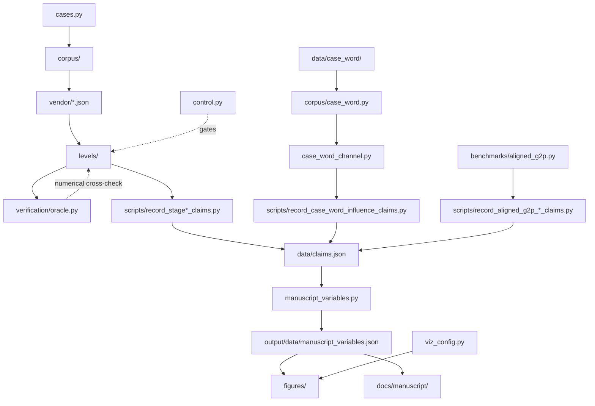

# ailm/ — the AILM library

Everything AILM is, minus the orchestration: **the model**, **the corpora it
learns from**, **the instruments that check it**, and **the bookkeeping that
keeps its numbers honest**.

## What lives here

The exhaustive, module-by-module package map is
[`docs/architecture.md`](../../docs/architecture.md#package-map). That map names
each module's ownership, allowed imports, and exercising tests, and a repository
test checks it against every shipped Python module. This README deliberately
does not copy that inventory or count modules: either would become a second,
unguarded source of architectural truth.

## Quick start

```python
from ailm.claims import load_ledger
from ailm.control import ControlHarness
from ailm.levels.phoneme import (
    build_phone_transition, build_phone_unigram,
    build_phoneme_agent, compute_phoneme_perplexity, load_phoneme_counts,
)

counts = load_phoneme_counts()
agent = build_phoneme_agent(
    build_phone_transition(counts["phone_bigrams"]),
    build_phone_unigram(counts["phone_unigrams"]),
)
```

## How the pieces relate



The dashed edges are the two things that make this project different from a pile of
scripts. `verification/oracle.py` is an independent instrument, so a pymdp number can
be *disagreed with* rather than merely believed. `control.py` makes a gate prove it
can fail before it is allowed to certify anything.

## The two invariants a newcomer would otherwise violate

**1. Learned sequence statistics go in the transition `B`, not the emission `A`.**
Stage 1 shipped the inverse. Observing symbol `c` then yields a posterior over the
symbol that *preceded* `c`, and an identity `B` carries that backward-looking belief
forward as the next-symbol prediction. Measured cost:
claim:stage1_anti_informative_perplexity against
claim:stage1_letter_perplexity for correct wiring — and on a small in-sample corpus
it scored worse than uniform while still slipping under a naive threshold. pymdp
cannot help: a bigram matrix is column-stochastic in either slot, so `_validate()`
accepts both. Orientation is checked numerically against `verification/oracle.py`,
with structural axis/role checks as complementary guards; generic stochasticity
alone does not establish orientation.

**2. No number lives here as a literal.** `claims.py` is the source of numeric truth
and `manuscript_variables/` is the only bridge from it into prose and figures. If
you need a value with no ledger label, record it with a recorder in `scripts/` —
do not type it. `tests/test_claims_discipline.py` scans every docstring in this
package for `claim:<label>` tags and fails on an unbacked one.

## Verification

```bash
cd "$(git rev-parse --show-toplevel)"   # the repository root
.venv/bin/python -m pytest tests/ --cov=ailm --cov-report=term-missing
```

## More information

[`AGENTS.md`](AGENTS.md) for agent boundaries. Design rationale in
`../../docs/design/`; the level hierarchy in `../../docs/design/architecture.md`.
